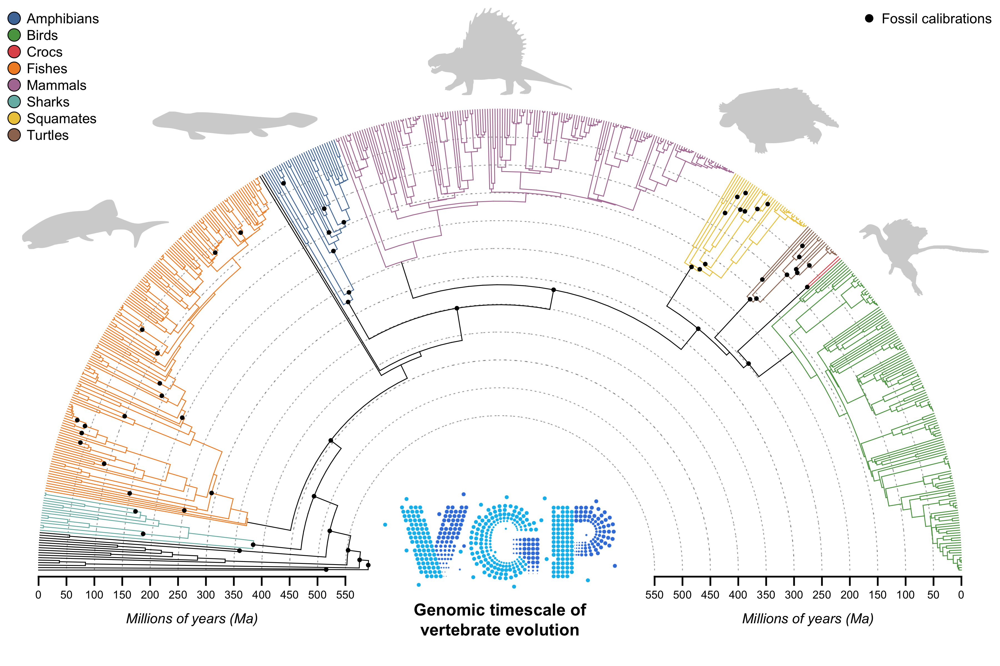

# VGP Phase I dating – assembling fossil calibrations

## Team
**Coordinator:** Alex Pyron (rpyron@gwu.edu) – GWU

**Contributors:**\
Sandra Álvarez-Carretero (s.alvarez-carretero@ucl.ac.uk) – UCL\
Dahiana Arcila (dkarcila@ucsd.edu) – UCSD\
Robert Asher (r.asher@zoo.cam.ac.uk) – Cambridge\
Ricardo Betancur (rbetancur@ucsd.edu) – UCSD\
Ed Braun (ebraun68@ufl.edu) – UFL\
Chase Brownstein (chase.brownstein@yale.edu) – Yale\
Santiago Claramunt (sclaramu@uno.edu) – UNO\
Phillip Donoghue (Phil.Donoghue@bristol.ac.uk) – Bristol\
Daniel Field (djf70@cam.ac.uk) – Cambridge\
Delson Hays (dhhays@ucsd.edu) – UCSD\
Jon Hughes (hughesjonjames@gmail.com) – ASU\
Laura Mulvey (laura.mulvey@qmul.ac.uk) – QMUL\
Tom Near (thomas.near@yale.edu) – Yale\
Mario dos Reis (m.dosreisbarros@qmul.ac.uk) – QMUL\
Mark Scherz (mark.scherz@gmail.com) – SNM/UCPH\
Tiago Simões (simoes@princeton.edu) – Princeton\
Josefin Stiller (josefin.stiller@bio.ku.dk) – UCPH\
Nate Upham (nathan.upham@asu.edu) – ASU

## [Calibrations](./calibrations/calibrations.md) & [dating](./treePL/treePL.md)

We have assembled a [final set](./calibrations/calibrations.md) of **$XXX** calibrations from our working group. For each clade, we also have Google Docs to keep track of our discussions for [Amphibians & Reptiles](https://docs.google.com/document/d/1VMTsPOSn6-E8yx2SoGJ6JiWdQ-omS7DwejFJVYD-AxQ/edit?usp=sharing), [Birds](https://docs.google.com/document/d/1G3ztyJx8t66nX5fdmEJtjLbXIoATYab_lRFytgtN4-A/edit?usp=sharing), [Fishes](https://docs.google.com/document/d/1peTTM31qZX1y7SY2SgsUnMst2tot416lubJ-ppSi1_s/edit?usp=sharing), [Mammals](https://docs.google.com/document/d/1fdghXoPY2i9wUCyBZXstzkNecUCnA5Q7V5yTdWLWg14/edit?usp=sharing), and [early nodes](https://docs.google.com/document/d/1XepP4Q753V84ACbQf73-WcU__SS8bk1m9IkEs7GVPsA/edit?usp=sharing). For exploratory analyses to generate immediate results as we go, I have set up initial testing pipelines using [treePL](./treePL/treePL.md) to generate a preliminary genomic timescale of vertebrate evolution. 

We are using Bayesian dating methodologies implemented in [mcmctree](https://github.com/dosreislab/mcmctree) to extract the greatest accuracy and precision from our whole-genome data. This fulfils a core aim of the VGP in demonstrating how these  data allow superior inference over previous approaches with smaller molecular datasets, less-comprehensive sets of fossil-calibration densities on node ages, and less-sophisticated computational algorithms.

## Approach

We used the [VGP Phase I](https://github.com/VGP/vgp-trees/tree/main/phase-1) [guide trees](https://github.com/VGP/vgp-dating/blob/main/trees/roadies_v1.1.16b.numbers.scientific.nwk.pdf) to place nodal constraints on a reference topology. Given the limited taxon sampling and absence of fossil tips, this endeavor was in many ways simplified and reminiscent of earlier eras in the field of divergence-time estimation. Our primary aim was to generate well-constrained ranges for a variety of nodes across the tree, to produce a robustly calibrated timescale for vertebrate evolution. These calibrations are congruent with the most up-to-date discoveries in the fossil record.

This resulted in a harmonized collection of min & max ages scattered and spaced across the tree. Given the increasing prevalence of fossil-tip-dated phylogenies, much of the previous ambiguity and controversy over the placement and applicability of many fossils was partially alleviated. Generally speaking, we sought the earliest-known crown-group fossils for major clades, to place minimum ages on the MRCA of extant taxa within those lineages. For a set of major named nodes, we also compiled existing consensus estimates for the origin of various groups from the literature, to compare congruence and divergence from previous generations of studies.

## Syntax

Our [reference tree](./trees/roadies_v1.1.16b.numbersScientific.nwk.pdf) is the VGP Phase I guide phylogeny, based on [roadies_v1.1.16b.nwk](https://github.com/VGP/vgp-trees/blob/main/phase-1/roadies_v1.1.16b.nwk) with APE-style [node numbers](https://github.com/VGP/vgp-trees/blob/main/phase-1/roadies_v1.1.16b.numbers.nwk) from R to facilitate objective reference to [nodes](./trees). Minimal documentation for each constraint is:

	-Node number and lineage
	-Type of calibration: I–IV
	-Minimum and maximum ages in Ma: e.g., 234.5,456.2
	-Associated fossil material and rationale
	-Citations and references

We explicitly modeled our calibrations to meet [best practices](https://academic.oup.com/sysbio/article/61/2/346/1647963) for justifying constraints with the following minimal information included for material, rationale, and references:

	-(1) Museum numbers of specimen(s) that demonstrate all the relevant characters and provenance data should be listed. Referrals of additional specimens to the focal taxon should be justified.
	-(2) An apomorphy-based diagnosis of the specimen(s) or an explicit, up-to-date, phylogenetic analysis that includes the specimen(s) should be referenced.
	-(3) Explicit statements on the reconciliation of morphological and molecular data sets should be given.
	-(4) The locality and stratigraphic level (to the best of current knowledge) from which the calibrating fossil(s) was/were collected should be specified.
	-(5) Reference to a published radioisotopic age and/or numeric timescale and details of numeric age selection should be given.

For some nodes such as the root,  calibrations will primarily refer to stratigraphic ranges based on initial taxon appearances and expert-assessed consensus for the upper bounds. An example is the root, which [likely dates](https://www.nature.com/articles/nature16150) to the mid-Ediacaran ~570Ma. The impact of fossils is more indirect in these instances. Only a few nodes should receive calibrations like this, mostly towards the root and in the outgroups.

Many nodes will be calibrated by the classic implementation of well-characterized fossils that are widely considered to represent the earliest stem- or crown-group members of a clade based on diagnostic taxonomic characteristics or morphological phylogenetic analyses, but which have not been included in a total-evidence analyses for fossil-tip dating. Such fossils provide strong minimum ages, with maximum bounds set according to usual principles such as the stratigraphic range or the next-oldest constrained divergence – an [extensive literature](https://palaeo-electronica.org/content/fc-1) exists for this question. Ideally, this type of calibration will be minimal, as many fossils will ideally have been included in recent tip-dated trees.

Finally, the ideal type of calibration will derive from a recent total-evidence phylogenetic analysis that includes the fossil of interest and therefore provides an objective reference for its placement close to the relevant node in our tree, along with a median age estimate and confidence interval on the stem and crown ages. Ideally, most of our calibrations will derive from such sources. Luckily, many such estimates have been published recently for most major clades, so each team has an extensive set of resources from which to work.

## Robustness

For a small number of fossils, controversy and disagreement over their phylogenetic placement precluded unambiguous assignment to crown groups in our analyses. Consequently, we assessed the robustness of our anayses by conducting additional runs with and without these constraints to evaluate their impact on estimated node-ages. Since the primary [mcmctree](https://github.com/dosreislab/mcmctree) analyses use independent clock rates across branches, we hypothesize that the impacts of these controversial calibrations should be locally restricted.

Additionally, we derived the empirical distribution of dates and ages for a set of clades (perhaps all Superorders and subtending nodes) from [timetree.org](http://timetree.org) and additional surveys of the recent literature, giving a broadly sampled prior distribution from combined previous studies. This empirical prior was used to generate [likelihood checkpoints](https://pubmed.ncbi.nlm.nih.gov/20525629/), employed as post-hoc probabilistic calibration checks. This allowed us to quantify congruence with and deviation from existing estimates on a per-node basis.
