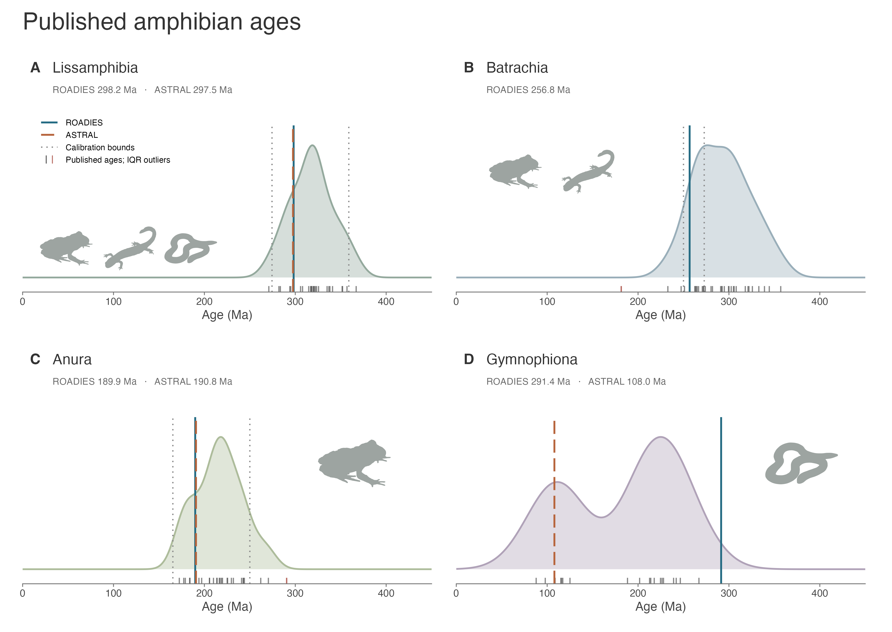

# Amphibia calibrations

There are relatively few amphibians sampled in our tree, and relatively few amphibian fossils that have been robustly estimated in total-evidence analyses. Consequently, we rely primarily on a few well-constrained fossil taxa that appear to share robustly diagnostic synapomorphies with major crown groups. Reassuringly, molecular divergence-time estimates for lissamphibians have been relatively consistent across most recent studies, such that variability in estimated ages is not a major area of uncertainty for this group. In particular, we refer to the results of [Feng et al. (2017)](https://www.pnas.org/doi/abs/10.1073/pnas.1704632114) for frogs, [Hime et al. (2021)](https://academic.oup.com/sysbio/article/70/1/49/5828236) for all amphibians, and [Stewart and Wiens (2025)](https://www.sciencedirect.com/science/article/pii/S1055790324002641) for salamanders as the most recent comprehensive studies with detailed discussion of fossil calibrations and age estimates. While some groups such as salamanders have a rich Cenozoic record ([Holman 2006](https://iupress.org/9780253347329/fossil-salamanders-of-north-america/)), many of these are not applicable at the phylogenetic scale analyzed here. Note that we follow the revised nomenclature of [Dubois et al. (2021)](https://www.mapress.com/mt/article/view/38637), which may differ from some of the more familiar names known to many readers from recent publications.

### Calibrations:

**CAL032:** Lissamphibia | 274.4–358.9Ma\
**Tree mappings:** ROADIES node 948; ASTRAL node 745.\
**Node calibrated:** Last common ancestor of the clade encompassing caecilians (Gymnophiona), frogs (Anura), and salamanders (Urodela). The selected species are _Rhinatrema bivittatum_ (Gymnophiona: Rhinatrematidae) and _Engystomops pustulosus_ (Anura: Leptodactylidae).\
**Fossil taxon:** †_Gerobatrachus hottoni_ (USNM 489135)\
**Minimum age:** 274.4Ma\
**Minimum justification:** From the Leonardian (~270–280Ma) of the early Permian, locality number USNM 40971: ‘Don's Dump Fish Quarry’ in the Clear Fork Group from Baylor County, Texas, USGS Soap Creek 7.5' quad ([Anderson et al. 2008](https://www.nature.com/articles/nature06865)). The age of this formation is roughly contemporaneous with the Kungurian (274.4–283.3Ma; [Lucas et al. 2022](https://www.researchgate.net/publication/357993752_Middle_Kungurian_Early_Permian_seaways_in_the_southwestern_USA)). †_Gerobatrachus_ exhibits a number of features suggesting that it is a stem batrachian ([Anderson et al. 2008](https://www.nature.com/articles/nature06865)), while other recent analyses suggest it is a stem lissamphibian and caution its use to calibrate crown Lissamphibia ([Kligman et al. 2023](https://www.nature.com/articles/s41586-022-05646-5)). However, much of this uncertainty relates to a separate debate over the fossil ancestry of Lissamphibia (e.g., origins in Lepospondyli or Temnospondyli), which does not necessarily affect constraints for the extant lineages. Either way, essentially all recent estimates for Lissamphibia predate this taxon, including those that did not use it as a calibration. The existence of putative synapomorphies allying it with  the stem of Batrachia indicate that these character states, representative of crown lissamphibians, were present by the end of the early Permian ([Pardo et al. 2020](https://www.frontiersin.org/journals/genetics/articles/10.3389/fgene.2020.506749/full)). Consequently, we follow [Anderson et al. (2008)](https://www.nature.com/articles/nature06865) in treating it as a stem batrachian, providing a credible minimum bound for the age of Lissamphibia.\
**Maximum age:** 358.9Ma.\
**Maximum justification:** In contrast, we remain more agnostic regarding the maximum bound. Molecular estimates range from the middle Permian to the late Devonian (270.9–367.0Ma; [Kligman et al. 2023](https://www.nature.com/articles/s41586-022-05646-5)). We place a tentative soft maximum age of 358.9Ma on this node, corresponding to the Devonian–Carboniferous boundary.\
**Discussion:** [Anderson et al. (2008)](https://www.nature.com/articles/nature06865) suggested a minimum age of 328–335Ma for the age of crown Lissamphibia based on the earliest appearance of lepospondyls and temnospondyls together. However, recent molecular estimates such as [Feng et al. (2017)](https://www.pnas.org/doi/10.1073/pnas.1704632114), [Hime et al. (2021)](https://academic.oup.com/sysbio/article/70/1/49/5828236), and [Stewart and Wiens (2025)](https://www.sciencedirect.com/science/article/pii/S1055790324002641) – potentially misreading [Anderson (2008)](https://link.springer.com/article/10.1007/s11692-008-9044-5) – confusingly placed a maximum age of 337Ma on this node. [Kligman et al. (2023)](https://www.nature.com/articles/s41586-022-05646-5) – despite disagreeing with Anderson et al. (2008) regarding the fossil ancestors of Lissamphibia – nevertheless concur in supporting a Mississippian Carboniferous origin (323.4–358.9Ma) of Lissamphibia. We conservatively set a minimum age based on the oldest putative stem batrachian †_Gerobatrachus_, with a maximum that modestly predates the proposed Mississippian origin ([Kligman et al. 2023](https://www.nature.com/articles/s41586-022-05646-5)). This range encompasses essentially all previous molecular divergence-time estimates, regardless of calibration strategy. A more conservative minimum age would be the Permian–Triassic boundary ~250Ma based on the crown batrachian and stem anuran †_Triadobatrachus_ (see **CAL033** below). Given that †_Triadobatrachus_ exhibits characteristics of anatomically modern frogs by the early Triassic and †_Gerobatrachus_ exhibits putatively batrachian characteristics by the end of the early Permian, using the former as a hard minimum age for Batrachia and the latter as a soft minimum age for Lissamphibia is a conservative approach that is phylogenetically and stratigraphically congruent with the known fossil record (see [Pardo et al. 2020](https://www.frontiersin.org/journals/genetics/articles/10.3389/fgene.2020.506749/full) and references therein).

---

**CAL033:** Batrachia | 250.0–272.8Ma\
**Tree mappings:** ROADIES node 949; Not implemented in the current ASTRAL tree (defining taxa absent).\
**Node calibrated:** Last common ancestor of the clade encompassing frogs (Anura), and salamanders (Urodela). The selected species are _Ambystoma mexicanum_ (Urodela: Ambystomatidae) and _Engystomops pustulosus_ (Anura: Leptodactylidae).\
**Fossil taxon:** †_Triadobatrachus massinoti_ (MNHN.F.MAE 126)\
**Minimum age:** 250.0Ma\
**Minimum justification:** The earliest unambiguous stem anuran based on a number of synapomorphies ([Ruta and Coates 2007](https://www.tandfonline.com/doi/abs/10.1017/S1477201906002008)), from the base of the middle part of the Sakamena Group in northern Madagascar dated imprecisely to the earliest Triassic for which we use 250.0Ma ([Benton et al. 2015](https://palaeo-electronica.org/content/fc-1)).\
**Maximum age:** 272.8Ma\
**Maximum justification:** [Benton et al. (2015)](https://palaeo-electronica.org/content/fc-1) suggested a soft maximum age in the middle Permian, which agrees with the recommendation of [Anderson et al. (2008)](https://www.nature.com/articles/nature06865) based on †_Gerobatrachus_ as a stem batrachian.\
**Discussion:** This taxon was strongly supported as a stem anuran by the total-evidence dating analysis of [Pyron (2011)](https://academic.oup.com/sysbio/article/60/4/466/1611723), reinforcing its use as a minimum bound on the age of Batrachia.

---

**CAL034:** Anura | 165.3–250.0Ma\
**Tree mappings:** ROADIES node 950; ASTRAL node 748.\
**Node calibrated:** Last common ancestor of the clade encompassing all extant frogs. The selected species are _Ascaphus truei_ (Anura: Ascaphidae) and _Engystomops pustulosus_ (Anura: Leptodactylidae).\
**Fossil taxon:** †_Eodiscoglossus oxoniensis_ (NHMUK R11700)\
**Minimum age:** 165.3Ma\
**Minimum justification:** The earliest unambiguous crown anuran based on a number of synapomorphies ([Evans et al. 1990](https://palass.org/sites/default/files/media/publications/palaeontology/volume_33/vol33_part2_pp299-311.pdf), [Ruta and Coates 2007](https://www.tandfonline.com/doi/abs/10.1017/S1477201906002008)), from the middle Jurassic Forest Marble Formation, upper Bathonian of Oxfordshire, England ([Benton et al. 2015](https://palaeo-electronica.org/content/fc-1)). \
**Maximum age:** 250.0Ma\
**Maximum justification:** [Benton et al. (2015)](https://palaeo-electronica.org/content/fc-1) suggested a soft maximum age at the Triassic–Jurassic boundary, given other stem anurans and small tetrapods from numerous deposits at that time without any apparent crown anurans. Given that many estimates have exceeded this range (see below), we place a more conservative soft maximum on this age based on the Permian–Triassic boundary, the minimum age for Batrachia.\
**Discussion:** The total-evidence analysis of [Chen et al. 2016](https://www.nature.com/articles/srep19209) estimated the putative congener †_Eodiscoglossus santonjae_ in the crown of Anura, corroborated by the morphological re-description by [Baez and Gomez 2016](https://ri.conicet.gov.ar/handle/11336/60180) and re-analysis by [Gao and Chen 2017](https://bioone.org/journals/American-Museum-Novitates/volume-2017/issue-3876/3876.1/A-New-Crown-Group-Frog-Amphibia--Anura-from-the/10.1206/3876.1.short). This taxon dates to the Barremian (121.4–125.8Ma) of the early Cretaceous La Pedrera de Rúbies Formation and El Castellar Formation of Spain. Other putative crown-group anurans are known from similar ages as summarized in [Gómez and Lires 2019](https://www.sciencedirect.com/science/article/pii/S1631068319301320), but these are not as well-documented.

---

**CAL035:** Dorsipares | 148.1–201.5Ma\
**Tree mappings:** ROADIES node 970; ASTRAL node 753.\
**Node calibrated:** Last common ancestor of the clade encompassing _Rhinophrynus dorsalis_ (Rhinophrynidae) and _Xenopus petersii_ (Pipidae).\
**Fossil taxon:** †_Rhadinosteus parvus_ (DINO 14693)\
**Minimum age:** 148.1Ma\
**Minimum justification:** From the Brushy Basin Member of the Morrison Formation, from the Kimmeridgian of the late Jurassic, in Dinosaur National Monument, Utah, USA. The sister group to _Rhinophrynus_ (Rhinophrynidae) based on a number of synapomorphies ([Henrici 1998](https://www.tandfonline.com/doi/abs/10.1080/02724634.1998.10011060)) and parsimony-based morphological phylogenetic analyses by [Báez (2013)](https://www.sciencedirect.com/science/article/abs/pii/S0195667112001607), [Agnolin et al. (2020)](https://www.sciencedirect.com/science/article/pii/S0895981120301462), and the supertree analysis of [Perez-Ben et al. (2024)](https://www.cambridge.org/core/journals/paleobiology/article/frog-limbs-in-deep-time-is-jumping-locomotion-at-the-roots-of-the-anuran-bauplan/AC8EC495E05D51667CAAE5B18FAD1E67).\
**Maximum age:** 201.5Ma\
**Maximum justification:** Given the similarity in ages, we follow [Benton et al. (2015)](https://palaeo-electronica.org/content/fc-1) for crown Anura in placing a soft maximum age at the Triassic–Jurassic boundary, given other stem anurans and small tetrapods from numerous deposits around that time without any apparent crown anurans.\
**Discussion:** The proper name for this clade is Dorsipares ([Dubois et al. 2021](https://www.mapress.com/mt/article/view/38637)), rather than Pipoidea as referred to by most authors ([Cannatella 2015](https://karger.com/cgr/article-abstract/145/3-4/283/62763)).

---

**CAL036:** Pelobatoidea | 85.7–143.1Ma\
**Tree mappings:** ROADIES node 969; ASTRAL node 756.\
**Node calibrated:** Last common ancestor of the clade encompassing _Pelobates fuscus_ (Pelobatidae) and _Pelodytes ibericus_ (Pelodytidae).\
**Fossil taxon:** †_Gobiates spinari_ (ZIN, LU-N 5/137)\
**Minimum age:** 85.7Ma\
**Minimum justification:** From the middle part of the Bissekty Formation, Coniacian of the late Cretaceous, at the Dzhyrakuduk (CBI-4b) locality in the central Kizylkum Desert, Uzbekistan (see [Roček 2008](https://www.sciencedirect.com/science/article/pii/S0195667108000098)).\
**Maximum age:** 143.1Ma\
**Maximum justification:** Given the relative scarcity of crown anurans from the late Jurassic while stem forms are prevalent (see [Benton et al. 2015](https://palaeo-electronica.org/content/fc-1)), we place a conservative soft maximum age on this clade corresponding to the Jurassic–Cretaceous boundary.\
**Discussion:** Members of this genus were originally described as crown pelobatoids based on numerous synapomorphies ([Borsuk-Bialynicka 1978](https://www.palaeontologia.pan.pl/Archive/1978_38_57-63_15.pdf)), though later authors suggested an indeterminate earlier-branching position ([Spinar and Tatarinov 1986](https://www.tandfonline.com/doi/abs/10.1080/02724634.1986.10011605), [Roček 2008](https://www.sciencedirect.com/science/article/pii/S0195667108000098)). A total-evidence dating analysis placed it as a crown pelobatoid ([Chen et al. 2016](https://www.nature.com/articles/srep19209)), though an updated re-analysis of that matrix placed it as a stem laevogyrinian ([Gao and Chen 2017](https://bioone.org/journals/american-museum-novitates/volume-2017/issue-3876/3876.1/A-New-Crown-Group-Frog-Amphibia--Anura-from-the/10.1206/3876.1.short)). However, that latter analysis produced a seemingly-impossible Cenozoic origin of Laevogyrinia, which typically dates to the middle Jurassic ([Feng et al. 2017](https://www.pnas.org/doi/abs/10.1073/pnas.1704632114), [Hime et al. 2021](https://academic.oup.com/sysbio/article/70/1/49/5828236)). On balance, the evidence appears to point towards a crown pelobatoid affinity for †_Gobiates_ and a Cretaceous origin of Pelobatoidea.

---

**CAL037:** Aquipares | 113.0–143.1Ma\
**Tree mappings:** ROADIES node 954; ASTRAL node 757.\
**Node calibrated:** Last common ancestor of the clade encompassing _Hyla sarda_ (Hyloidea) and _Rana temporaria_ (Ranoidea).\
**Fossil taxon:** †_Kururubatrachus gondwanicus_ (UFRJ-DG 08 A)\
**Minimum age:** 113.0Ma\
**Minimum justification:** A member of the crown group Aquipares based on several synapomorphies, from the Pedra Branca Mine, Nova Olinda County, Ceará State, Brazil, part of the early Cretaceous Crato Formation from the Aptian ([Carvalho et al. 2019](https://www.sciencedirect.com/science/article/abs/pii/S0895981118305285), [Agnolin et al. 2020](https://www.sciencedirect.com/science/article/pii/S0895981120301462)).\
**Maximum age:** 143.1Ma\
**Maximum justification:** Given the relative scarcity of crown anurans from the late Jurassic while stem forms are prevalent (see [Benton et al. 2015](https://palaeo-electronica.org/content/fc-1)), we place a conservative soft maximum age on this clade corresponding to the Jurassic–Cretaceous boundary.\
**Discussion:** Other taxa of similar ages from the Crato formation such as †_Eurycephalella alcinae_ have also been estimated as members of crown Aquipares based on parsimony analyses of morphology ([Evans et al. 2014](https://journals.plos.org/plosone/article?id=10.1371/journal.pone.0087236)). The age of Ranomorpha (Helanura + Aquipares) typically dates to the early Cretaceous ([Feng et al. 2017](https://www.pnas.org/doi/abs/10.1073/pnas.1704632114), [Hime et al. 2021](https://academic.oup.com/sysbio/article/70/1/49/5828236)). Consequently, the Jurassic–Cretaceous boundary is a conservative soft maximum age for Aquipares. [Báez (2013)](https://www.sciencedirect.com/science/article/pii/S0195667112001607) and [Agnolin et al. (2020)](https://www.sciencedirect.com/science/article/pii/S0895981120301462) also estimated †_Wealdenbatrachus_ from the early Cretaceous of Spain as a member of crown Aquipares using parsimony analyses of morphology, which would push the minimum age for this clade back to ~125Ma. However, this topology was not supported by [Báez and Gómez (2019)](https://www.sciencedirect.com/science/article/pii/S0195667118304099) or [Gómez and Lires (2019)](https://www.sciencedirect.com/science/article/pii/S1631068319301320), who recovered a much earlier-branching position in crown Anura. Consequently, we do not employ †_Wealdenbatrachus_ as a constraint here for Aquipares, although a date of ~125–130Ma is consistent with recent estimates for the age of this node ([Feng et al. 2017](https://www.pnas.org/doi/abs/10.1073/pnas.1704632114), [Hime et al. 2021](https://academic.oup.com/sysbio/article/70/1/49/5828236)).

---

**CAL038:** Salamandroidea | 62.0–143.1Ma\
**Tree mappings:** ROADIES node 973; Not implemented in the current ASTRAL tree (defining taxa absent).\
**Node calibrated:** The most recent common ancestor of Ambystomatidae (_Ambystoma mexicanum_) and Salamandridae (_Triturus cristatus_)\
**Fossil taxon:** †_Dicamptodon antiquus_ (UALVP 32387) from the Paskapoo Formation (Paleocene) of Alberta, Canada ([Naylor and Fox 1993](https://doi.org/10.1139/e93-067))\
**Minimum age:** Early Paleocene (Danian), 62.0Ma\
**Minimum justification:** This taxon bears numerous synapomorphies uniting it with the stem of extant species of _Dicamptodon_, providing a credible minimum age for the crown of Ambystomatidae, and therefore Salamandroidea by extension. It originated from Location 1 from the Paskapoo Formation ([Wilson 1980](https://doi.org/10.1139/e80-030)), which was previously radiometrically dated to ~62Ma ([Christophel 1976](https://www.schweizerbart.de/papers/palb/detail/157/72190/Fossil_floras_of_the_Smoky_Tower_locality_Alberta_)).\
**Maximum age:** Jurassic–Cretaceous boundary, 143.1Ma\
**Maximum justification:** We use a conservative soft maximum age corresponding to the Jurassic–Cretaceous boundary, as numerous stem but no unambiguous crown salamanders are known from the Jurassic ([Jones et al. 2022](https://doi.org/10.1073/pnas.2114100119)).\
**Discussion:** This is a revision of constraint #19 from Stewart and Wiens ([2025](https://doi.org/10.1016/j.ympev.2024.108272)). They assigned this specimen to the Tiffanian, ~56.8–60.2Ma, but a more precise radiometric date was available from volcanic ash at the site.

---

**CAL039:** Pleurodelinae | 27.8–66.0Ma\
**Tree mappings:** ROADIES node 974; Not implemented in the current ASTRAL tree (defining taxa absent).\
**Node calibrated:** Last common ancestor of the clade encompassing Pleurodelini (_Pleurodeles waltl_) and Molgini (_Lissotriton helveticus_).\
**Fossil taxon:** Numerous specimens referrable to the extant genera _Lissotriton_ and _Triturus_ from the late Oligocene, and aff. _Tylototriton_, _Triturus_, _Ichthyosaura_, and _Lissotriton_ from the early Miocene, from numerous Palearctic localities ([Macaluso et al. 2022](https://royalsocietypublishing.org/rsos/article/9/11/220935/96437/Biogeographic-history-of-Palearctic-caudates)). In particular, †_Lissotriton rohrsi_ (SMF A 614) and _Triturus_ sp. (SMF A 616) from Oberleichtersbach (Northern Bavaria, Germany), from the MP30 stage of the late Oligocene ([Böhme 2008](https://www.researchgate.net/publication/251832903_Ectotermic_vertebrates_Teleostei_Allocaudata_Urodela_Anura_Testudines_Choristodera_Crocodylia_Squamata_from_the_Upper_Oligocene_of_Oberleichtersbach_Northern_Bavaria_Germany)).\
**Minimum age:** Late Oligocene (Rupelian–Chattian boundary), 27.82Ma\
**Minimum justification:** The presence of numerous fossil newt taxa with apparent affinities to extant genera within Pleurodelini and Molgini near the Oligocene–Miocene boundary supports this as a conservative hard minimum age on their divergence ([Macaluso et al. 2026](https://doi.org/10.1038/s41598-026-44690-3)).\
**Maximum age:** Early Paleocene (Danian), 66.0Ma\
**Maximum justification:** Several early branching salamandrids (†_Duffaudiella_, †_Eotriton_, and †_Koaliella_) are known from the Eocene and Paleocene ([Macaluso et al. 2025](https://royalsocietypublishing.org/rspb/article/292/2052/20251333/234515)), supporting the K–Pg boundary as a conservative soft maximum age for Pleurodelinae.\
**Discussion:** [Hime et al. (2021)](https://academic.oup.com/sysbio/article/70/1/49/5828236) estimated the age of this node at ~35Ma, consistent with the fossil evidence reviewed by [Macaluso et al. (2022)](https://royalsocietypublishing.org/rsos/article/9/11/220935/96437/Biogeographic-history-of-Palearctic-caudates) and the total-evidence analysis of [Macaluso et al. (2025)](https://royalsocietypublishing.org/rspb/article/292/2052/20251333/234515). In contrast, [Stewart and Wiens (2025)](https://www.sciencedirect.com/science/article/pii/S1055790324002641) liberally assigned Oligocene fossil material to the crown group of _Triturus_ and the early Eocene (Ypresian) †_Eotriton weigelti_ to the crown group of Pleurodelini, yielding dramatically older Paleocene ages for Pleurodelinae. These assignments are not supported by the taxonomic review or phylogenetic analysis of Macaluso et al. ([2022](https://royalsocietypublishing.org/rsos/article/9/11/220935/96437/Biogeographic-history-of-Palearctic-caudates), [2025](https://royalsocietypublishing.org/rspb/article/292/2052/20251333/234515)), and we therefore do not follow them here.

---

### New calibrations for ASTRAL

**Node $XXX:** Urodela | 125.0–251.9Ma\
**Node calibrated:** The most recent common ancestor of Cryptobranchidae (_Cryptobranchus alleganiensis_) and Plethodontidae (_Thorius spilogaster_)\
**Fossil taxon:** †_Valdotriton gracilis_ (LH 928061a–b and numerous paratypes) from the La Huérguina Formation (Cretaceous: upper Barremian) at the Las Hoyas fossil site, Cuenca Province, Spain ([Evans and Milner 1996](https://doi.org/10.1098/rstb.1996.0061))\
**Minimum age:** Cretaceous (upper Barremian), 125.0Ma\
**Minimum justification:** This taxon is a crown urodelan based on a number of synapomorphies ([Evans and Milner 1996](https://doi.org/10.1098/rstb.1996.0061)), and was estimated on the stem of Meantes + Pseudosauria by Jones et al. ([2022](https://doi.org/10.1073/pnas.2114100119)), who referred to that node as “Salamandroidea.” Consequently, it represents a credible minimum age for Urodela.\
**Maximum age:** Permian–Triassic boundary, 251.9Ma\
**Maximum justification:** For a maximum age, Benton et al. ([2015](https://doi.org/10.26879/424)) suggested a middle Jurassic limit of 175.1Ma based on the bracketing ostensibly indicated by another putative stem “salamandroid” †_Iridotriton hechti_ and the undescribed Kirtlington 'Salamander B' ([Evans et al. 2005](https://doi.org/10.1111/j.1096-3642.2005.00159.x)). However, there are numerous total-group salamanders from the Jurassic ([Jones et al. 2022](https://doi.org/10.1073/pnas.2114100119)), and both molecular and total-evidence estimates for the age of Urodela have ranged into the upper (i.e., late) Triassic ([Roelants et al. 2007](https://doi.org/10.1073/pnas.0608378104); [Pyron 2011](https://doi.org/10.1093/sysbio/syr047); [Jetz and Pyron 2018](https://doi.org/10.1038/s41559-018-0515-5)). In contrast, more recent studies have estimated a Jurassic origin ([Hime et al. 2021](https://doi.org/10.1093/sysbio/syaa034); Stewart and Wiens 2025). We conservatively use a soft maximum age derived from the Permian–Triassic boundary, allowing crown Urodela to encompass essentially all previous age estimates.\
**Discussion:** This is constraint #10 from Stewart and Wiens ([2025](https://doi.org/10.1016/j.ympev.2024.108272)). The resolution of numerous fossil salamanders from the late Jurassic and early Cretaceous might provide more precise minimum ages in the future ([Jones et al. 2022](https://doi.org/10.1073/pnas.2114100119)).

---

**Node $XXX:** Pseudosauria | 83.6–143.1Ma\
**Node calibrated:** The most recent common ancestor of Ambystomatidae (_Ambystoma mexicanum_) and Plethodontidae (_Thorius spilogaster_)\
**Fossil taxon:** †_Bishara backa_ (originally CCMGE 240/12177, with a neotype ZIN PH 2/172 and other associated material) from the Shakh-Shakh locality of the Bostobe Formation (Cretaceous: Santonian–Campanian), in the northeastern Aral Sea area of the Kyzylorda Region, Kazakhstan ([Skutschas et al. 2025](https://doi.org/10.1080/08912963.2024.2384108)).\
**Minimum age:** Cretaceous (Santonian–Campanian), 83.6Ma\
**Minimum justification:** The Bostobe Formation is Santonian–Campanian in age ([Skutschas 2013](https://doi.org/10.1007/s12549-013-0126-8)).\
**Maximum age:** Jurassic–Cretaceous boundary, 143.1Ma\
**Maximum justification:** We use a conservative soft maximum age corresponding to the Jurassic–Cretaceous boundary, as numerous stem but no unambiguous crown salamanders are known from the Jurassic ([Jones et al. 2022](https://doi.org/10.1073/pnas.2114100119)).\
**Discussion:** Newly described synapomorphies and a phylogenetic analysis place this taxon in crown Proteidae, sister to _Proteus_ to the exclusion of _Necturus_ relative to the extant taxa ([Skutschas et al. 2025](https://doi.org/10.1080/08912963.2024.2384108)). Even if treated as a total-group proteid (i.e., potentially a stem member), it nonetheless provides a credible minimum boundary for Pseudosauria. 

---

### Likelihood checkpoints:

There are well-documented times for likelihood checkpoints at the base of Amphibia from 53 studies. Previous estimates for Lissamphibia (Gymnophiona + Batrachia) with and without †_Gerobatrachus_ (depending on its placement as a stem batrachian) were previously compiled by [Kligman et al. (2023)](https://www.nature.com/articles/s41586-022-05646-5). We summarize those here to obtain a 95% CI from the quantiles. Those authors also summarized the published evidence for Batrachia (Salientia + Urodela) and Gymnophiona (Rhinatrematidae + Stegokrotaphia, which is Plesiophiona + Pseudophiona in the nomenclature of [Dubois et al. 2021](https://www.mapress.com/mt/article/view/38637)), to which we added Anura and analyzed in the same manner:

**948:** Lissamphibia (29): 279.0–360.0Ma (Median 318Ma)\
**949:** Batrachia (32): 244.0–347.0Ma (Median 292Ma)\
**950:** Anura (26): 175.0–265.0Ma (Median 217Ma)\
**977:** Gymnophiona (19): 92.0–258.0Ma (Median 213Ma)

## References

Agnolin, F., de Souza Carvalho, I., Rolando, A.M.A., Novas, F.E., Xavier-Neto, J., Andrade, J.A.F.G. and Freitas, F.I., 2020. Early Cretaceous neobatrachian frog (Anura) from Brazil sheds light on the origin of modern anurans. Journal of South American Earth Sciences, 101, p.102633.

Anderson, J.S., 2008. Focal Review: The Origin(s) of Modern Amphibians. Evolutionary Biology, 35, pp.231–247.

Anderson, J.S., Reisz, R.R., Scott, D., Fröbisch, N.B. and Sumida, S.S., 2008. A stem batrachian from the Early Permian of Texas and the origin of frogs and salamanders. Nature, 453(7194), pp.515-518.

Báez, A.M., 2013. Anurans from the Early Cretaceous Lagerstätte of Las Hoyas, Spain: new evidence on the Mesozoic diversification of crown-clade Anura. Cretaceous Research, 41, pp.90-106.

Báez, A.M. and Gomez, R.O., 2016. Revision of the skeletal morphology of Eodiscoglossus santonjae, an Early Cretaceous frog from northeastern Spain, with comments on its phylogenetic placement. Acta Musei Nationalis Pragae Series B Historia Naturalis 72(1-2):66-77.

Báez, A.M. and Gómez, R.O., 2019. Redescription of the overlooked basal frog Wealdenbatrachus reveals increased diversity among Early Cretaceous anurans. Cretaceous Research, 99, pp.14-29.

Benton, M. J., P. C. Donoghue, R. J. Asher, M. Friedman, T. J. Near, and J. Vinther. 2015. Constraints on the timescale of animal evolutionary history. Palaeontologia Electronica 18(1):1-106.

Böhme, M., 2008. Ectothermic vertebrates (Teleostei, Allocaudata, Urodela, Anura, Testudines, Choristodera, Crocodylia, Squamata) from the Upper Oligocene of Oberleichtersbach (Northern Bavaria, Germany). Courier Forschungsinstitut Senckenberg, 260, pp.161-183.

Borsuk-Bialynicka, M. 1978. Eopelobates leptocolaptus sp. n. - the first Upper Cretaceous pelobatid frog from Asia. Palaeontologia Polonica 38, 57–63.

Cannatella, D., 2015. Xenopus in space and time: fossils, node calibrations, tip-dating, and paleobiogeography. Cytogenetic and genome research, 145(3-4), pp.283-301.

Carvalho, I.S., Agnolin, F., Rolando, M.A.A., Novas, F.E., Xavier-Neto, J., Freitas, F.I. and Andrade, J.A.F.G., 2019. A new genus of pipimorph frog (Anura) from the Early Cretaceous Crato Formation (Aptian) and the evolution of South American tongueless frogs. Journal of South American Earth Sciences, 92, pp.222-233.

Chen, J., Bever, G.S., Yi, H.Y. and Norell, M.A., 2016. A burrowing frog from the late Paleocene of Mongolia uncovers a deep history of spadefoot toads (Pelobatoidea) in East Asia. Scientific Reports, 6(1), p.19209.

Christophel, D.C., 1976. Fossil floras of the Smoky Tower locality, Alberta, Canada. Palaeontographica Abteilung B, pp.1-43.

Dubois, A., Ohler, A. and Pyron, R.A., 2021. New concepts and methods for phylogenetic taxonomy and nomenclature in zoology, exemplified by a new ranked cladonomy of recent amphibians (Lissamphibia). Megataxa, 5(1), pp.1-738.

Evans, S.E. and Milner, A.R., 1996. A metamorphosed salamander from the Early Cretaceous of Las Hoyas, Spain. Philosophical Transactions: Biological Sciences, pp.627-646.

Evans, S.E., Milner, A.R. and Mussett, F., 1990. A discoglossid frog from the Middle Jurassic of England. Palaeontology, 33(2), pp.299-311.

Evans, S.E., Lally, C., Chure, D.C., Elder, A. and Maisano, J.A., 2005. A late Jurassic salamander (Amphibia: Caudata) from the Morrison formation of North America. Zoological Journal of the Linnean Society, 143(4), pp.599-616.

Evans, S.E., Groenke, J.R., Jones, M.E., Turner, A.H. and Krause, D.W., 2014. New material of Beelzebufo, a hyperossified frog (Amphibia: Anura) from the Late Cretaceous of Madagascar. PLoS One, 9(1), p.e87236.

Feng, Y.J., Blackburn, D.C., Liang, D., Hillis, D.M., Wake, D.B., Cannatella, D.C. and Zhang, P., 2017. Phylogenomics reveals rapid, simultaneous diversification of three major clades of Gondwanan frogs at the Cretaceous–Paleogene boundary. Proceedings of the national Academy of Sciences, 114(29), pp.E5864-E5870.

Gao, K.Q. and Chen, J., 2017. A new crown-group frog (Amphibia: Anura) from the Early Cretaceous of northeastern Inner Mongolia, China. American Museum Novitates, 2017(3876), pp.1-39.

Gómez, R.O. and Lires, A.I., 2019. High ecomorphological diversity among Early Cretaceous frogs from a large subtropical wetland of Iberia. Comptes Rendus Palevol, 18(7), pp.711-723.

Henrici, A. C. (1998). A new pipoid anuran from the Late Jurassic Morrison Formation at Dinosaur National Monument, Utah. Journal of Vertebrate Paleontology, 18(2), 321–332.

Hime, P.M., Lemmon, A.R., Lemmon, E.C.M., Prendini, E., Brown, J.M., Thomson, R.C., Kratovil, J.D., Noonan, B.P., Pyron, R.A., Peloso, P.L. and Kortyna, M.L., 2021. Phylogenomics reveals ancient gene tree discordance in the amphibian tree of life. Systematic biology, 70(1), pp.49-66.

Holman, J.A., 2006. Fossil salamanders of North America. Indiana University Press.

Jetz, W. and Pyron, R.A., 2018. The interplay of past diversification and evolutionary isolation with present imperilment across the amphibian tree of life. Nature ecology & evolution, 2(5), pp.850-858.

Jones, M.E., Benson, R.B., Skutschas, P., Hill, L., Panciroli, E., Schmitt, A.D., Walsh, S.A. and Evans, S.E., 2022. Middle Jurassic fossils document an early stage in salamander evolution. Proceedings of the National Academy of Sciences, 119(30), p.e2114100119.

Kligman, B.T., Gee, B.M., Marsh, A.D., Nesbitt, S.J., Smith, M.E., Parker, W.G. and Stocker, M.R., 2023. Triassic stem caecilian supports dissorophoid origin of living amphibians. Nature, 614(7946), pp.102-107.

Lucas, S.G., Henderson, C., Barrick, J.E. and Krainer, K., 2022. Middle Kungurian (Early Permian) seaways in the southwestern USA. Permophiles, 72, pp.48-51.

Macaluso, L., Mannion, P.D., Evans, S.E., Carnevale, G., Monti, S., Marchitelli, D. and Delfino, M., 2022. Biogeographic history of Palearctic caudates revealed by a critical appraisal of their fossil record quality and spatio-temporal distribution. Royal Society Open Science, 9(11), p.220935.

Macaluso, L., Villa, A., Rozzi, R., Fabre, A.C. and Mennecart, B., 2025. Time to grow up: the PETM climatic event favoured metamorphosing salamanders (Urodela, Salamandridae). Proceedings of the Royal Society B: Biological Sciences, 292(2052).

Macaluso, L., Jansen, O., Valentin, X., Walter, J.D., Otero, O., Amiot, R. and Garcia, G., 2026. New fossil evidence from the Late Cretaceous of Europe (southern France) deepens the origin of Salamandridae (Urodela) and refines the biogeography of the family. Scientific Reports, 16(1), p.16567.

Naylor, B.G. and Fox, R.C., 1993. A new ambystomatid salamander, Dicamptodon antiquus n. sp., from the Paleocene of Alberta, Canada. Canadian Journal of Earth Sciences, 30(4), pp.814-818.

Pardo, J.D., Lennie, K. and Anderson, J.S., 2020. Can we reliably calibrate deep nodes in the tetrapod tree? Case studies in deep tetrapod divergences. Frontiers in Genetics, 11, p.506749.

Pérez-Ben, C.M., Lires, A.I. and Gómez, R.O., 2024. Frog limbs in deep time: is jumping locomotion at the roots of the anuran Bauplan?. Paleobiology, 50(1), pp.96-107.

Pyron, R.A., 2011. Divergence time estimation using fossils as terminal taxa and the origins of Lissamphibia. Systematic biology, 60(4), pp.466-481.

Roček, Z., 2008. The Late Cretaceous frog Gobiates from Central Asia: its evolutionary status and possible phylogenetic relationships. Cretaceous Research, 29(4), pp.577-591.

Roelants, K., Gower, D.J., Wilkinson, M., Loader, S.P., Biju, S.D., Guillaume, K., Moriau, L. and Bossuyt, F., 2007. Global patterns of diversification in the history of modern amphibians. Proceedings of the National Academy of Sciences, 104(3), pp.887-892.

Ruta, M. and Coates, M.I., 2007. Dates, nodes and character conflict: addressing the lissamphibian origin problem. Journal of systematic Palaeontology, 5(1), pp.69-122.

Skutschas, P.P., 2013. Mesozoic salamanders and albanerpetontids of Middle Asia, Kazakhstan, and Siberia. Palaeobiodiversity and Palaeoenvironments, 93(4), pp.441-457.

Skutschas, P.P., Malakhov, D.V., Parakhin, I.A. and Kolchanov, V.V., 2025. New data on the crown proteid Bishara backa from the Upper Cretaceous (Bostobe Formation) of Kazakhstan: implications for early evolution and palaeobiogeography of Proteidae. Historical Biology, 37(7), pp.1706-1714.

Spinar, Z. V. & Tatarinov, L. P. 1986. A new genus and species of discoglossid frog from the Upper Cretaceous of the Gobi Desert. J. Vert. Paleontol. 6, 113–122.

Stewart, A.A. and Wiens, J.J., 2025. A time-calibrated salamander phylogeny including 765 species and 503 genes. Molecular Phylogenetics and Evolution, 204, p.108272.

Wilson, M.V., 1980. Oldest known Esox (Pisces: Esocidae), part of a new Paleocene teleost fauna from western Canada. Canadian Journal of Earth Sciences, 17(3), pp.307-312.
