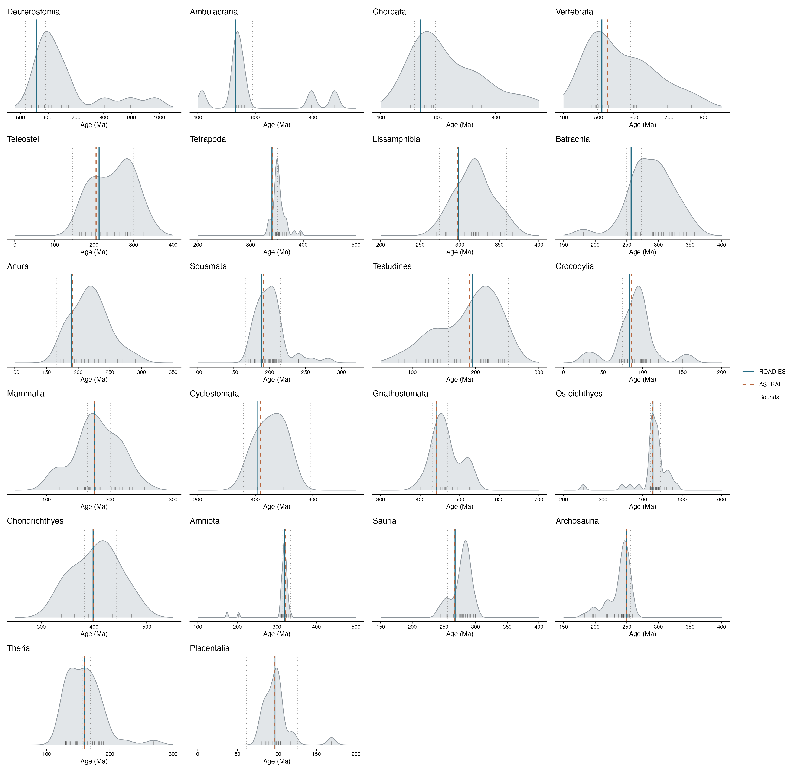
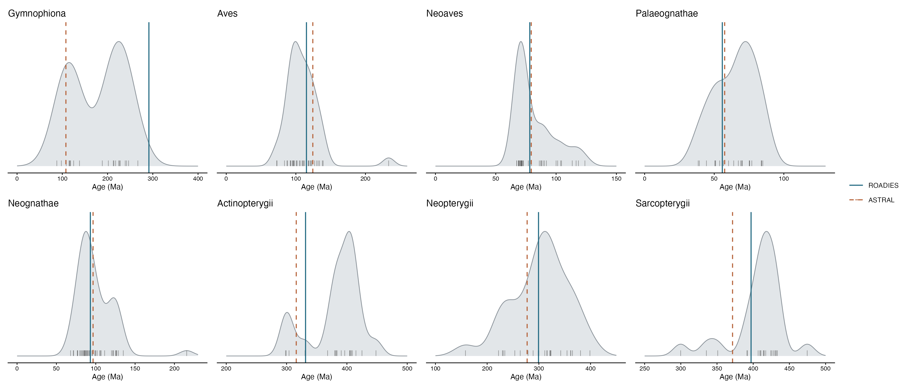

# Likelihood checkpoints

These figures compare published divergence-time estimates with the released ROADIES and ASTRAL MD-CAT trees. Vertical lines show the age of the specified taxon pair and current fossil calibration bounds. The released MD-CAT trees used an earlier calibration set, so their ages do not reflect all current bounds. A checkpoint is a comparison with published estimates, not an independent test when studies share data or calibrations.

### Nodes with direct fossil calibration bounds

### Nodes without direct fossil calibration bounds

The figures separate checkpoints with direct fossil calibration bounds from those without bounds at that node; other calibrations can still influence the latter. They plot all available point estimates together, including those from fossil-inclusive analyses. Regenerate them with `Rscript calibrations/plot_checkpoint_summary.R`.

| Clade | Checkpoint |
| --- | --- |
| Deuterostomia, Ambulacraria and Chordata | [Clade page and figures](outgroups/deuterostomia.md#likelihood-checkpoints) |
| Vertebrata, Cyclostomata, Gnathostomata and Osteichthyes | [Clade page and figures](vertebrates/vertebrata.md#likelihood-checkpoints) |
| Actinopterygii, Neopterygii, Teleostei and Chondrichthyes | [Clade page and figures](fishes/fishes.md#likelihood-checkpoints) |
| Sarcopterygii, Tetrapoda, Amniota, Sauria and Archosauria | [Clade page and figures](tetrapods/tetrapoda.md#likelihood-checkpoints) |
| Amphibia | [Clade page and figure](amphibia/amphibia.md#likelihood-checkpoints) |
| Squamata | [Clade page and figure](squamata/squamata.md#likelihood-checkpoints) |
| Testudines | [Clade page and figure](turtles/testudines.md#likelihood-checkpoints) |
| Crocodylia | [Clade page and figure](crocodylia/crocodylia.md#likelihood-checkpoints) |
| Mammalia, Theria and Placentalia | [Clade page and figures](mammals/mammalia.md#likelihood-checkpoints) |
| Aves, Neognathae, Neoaves and Palaeognathae | [Clade page and figures](birds/aves.md#likelihood-checkpoints) |

All checkpoint records are in [checkpoint_estimates.csv](checkpoint_estimates.csv), including previously compiled datasets and the new TimeTree exports. Rows contain estimates, available intervals and citations. Citation information is incomplete, and node equivalence has not yet been independently verified. TimeTree pairwise entries may include study-level estimates for related sampled taxa, rather than an analysis containing both exact species. Gymnophiona is intended to represent crown ages. The Cyclostomata estimate from Hedges (2001) is from a [book chapter](https://www.hedgeslab.org/pubs/124.pdf) for which no chapter DOI was found. Figures generated by the shared script can be regenerated with `Rscript calibrations/plot_checkpoints.R`.

Earlier checkpoints retain their existing plotting scripts, linked on their clade pages; these now read the shared table. See [PhyloPic credits](PHYLOPIC_CREDITS.md) for the silhouettes.
