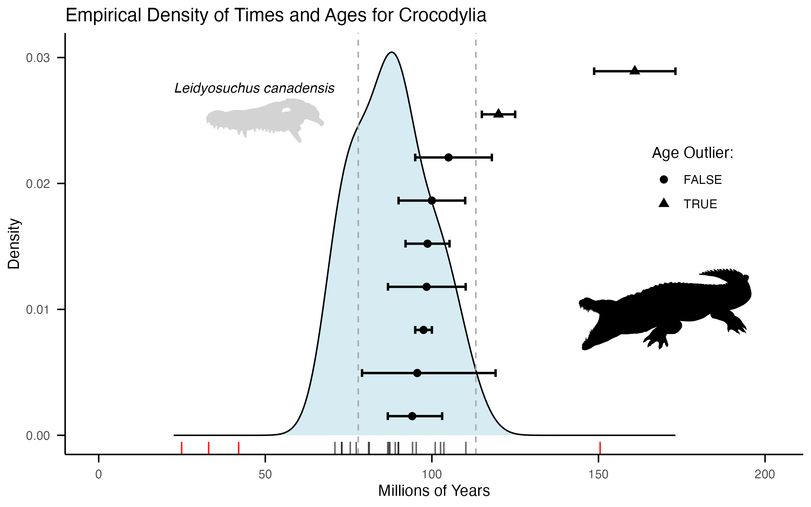

# Crocodylia calibrations

The root node (**CAL083:** Crocodylia), separating _Alligator_ and _Gavialis_, generally dates to the Late/Upper Cretaceous, ~90Ma, based on fossil and molecular estimates (see below). While there is an extensive crocodilian fossil record – both stem and crown – dating back to the Triassic ([Stockdale and Benton 2021](https://doi.org/10.1038/s42003-020-01561-5), [Payne et al. 2024](https://doi.org/10.1038/s41559-023-02244-0)), there are only a few well-constrained fossils in the vicinity of crown Crocodylia based on recent total-evidence phylogenetic analyses ([Lee and Yates 2018](https://doi.org/10.1098/rspb.2018.1071), [Darlim et al. 2022](https://doi.org/10.1098/rsbl.2021.0603), [Zamora-Vega et al. 2025](https://doi.org/10.1098/rsbl.2025.0238)). With expanded future taxon sampling, we can also calibrate **CAL $X:** Longirostres based on consensus between these different phylogenetic estimates regarding the oldest-known crown longirostran †_Kentisuchus_, which is confidently placed on the stem of Gavialidae to the exclusion of Crocodylidae.

CAL identifiers refer to records in the [master calibration list](../master_calibrations.csv). Tree mappings give the corresponding node numbers in [ROADIES v0.0.0](../../trees/roadies_v1.1.16b.numbers.nwk) (`roadies_v1.1.16b`) and [ASTRAL v0.1.1](../../trees/astralpro.l6p1.numbers.nwk) (`astralpro.l6p1`).

### Calibrations:

**CAL083:** Crocodylia | 74.4–113.2Ma\
**Tree mapping:** ROADIES node 731; ASTRAL node 993\
**Node calibrated:** The most recent common ancestor of Gavialoidea (_Gavialis gangeticus_: Gavialidae) and Alligatoroidea (_Alligator mississippiensis_: Alligatoridae)\
**Fossil taxa:** †_Leidyosuchus canadensis_ (NMC 338, 1551) from the Dinosaur Park Formation, Alberta, Canada ([Lambe, 1907](https://www.biodiversitylibrary.org/page/10884799))\
**Minimum age:** Late Cretaceous (Campanian), 74.4Ma\
**Minimum justification:** The oldest-known fossil confidently placed in crown Crocodylia is †_Leidyosuchus canadensis_ [Lambe, 1907](https://www.biodiversitylibrary.org/page/10884799) from the Dinosaur Park Formation (Cretaceous: Campanian, 76.5–74.4Ma), the uppermost member of the Belly or Judith River Group of Alberta, Canada ([Ramezani et al. 2022](https://doi.org/10.1038/s41598-022-19896-w), [Eberth et al. 2023](https://doi.org/10.1139/cjes-2023-0037)). This taxon is supported as an early crown-group member of Crocodylia by numerous synapomorphies and morphological phylogenetic analyses ([Brochu 1997](https://www.tandfonline.com/doi/abs/10.1080/02724634.1997.10011017), [Wilberg et al. 2019](https://doi.org/10.1038/s41598-018-36795-1), [Rio and Mannion 2021](https://doi.org/10.7717/peerj.12094), [Groh et al. 2022](https://doi.org/10.1111/pala.12589); but see [Walter et al. 2025](https://doi.org/10.1038/s42003-025-07653-4) for a potential stem placement). This topology is also supported by several time-calibrated and total-evidence analyses (see below), generally on the stem of Alligatoroidea ([Lee and Yates 2018](https://doi.org/10.1098/rspb.2018.1071), [Darlim et al. 2022](https://doi.org/10.1098/rsbl.2021.0603), [Zamora-Vega et al. 2025](https://doi.org/10.1098/rsbl.2025.0238)).\
**Maximum age:** Early Cretaceous (Aptian–Albian), 113.2Ma\
**Maximum justification:** A conservative maximum bound is the Aptian-Albian boundary (113.2Ma), as the lower 95% CI of both timetrees and total-evidence estimates is 107Ma and 108Ma, respectively, congruent with the density of stem crocodylians and absence of any crown members in the early Cretaceous ([Rio and Mannion 2021](https://doi.org/10.7717/peerj.12094), [Walter et al. 2025](https://doi.org/10.1038/s42003-025-07653-4); but see [Groh et al. 2022](https://doi.org/10.1111/pala.12589) for a potentially older time-scale)\
**Discussion:** Other time-scaled parsimony analyses such as [Salas-Gismondi et al. 2019](https://www.tandfonline.com/doi/full/10.1080/14772019.2018.1495275) also support a Late Cretaceous origin for Crocodylia and a crown placement of †_Leidyosuchus_, but do not report their exact age estimates and were therefore not considered

### Future calibrations for larger tree

**CAL $X:** Longirostres | 51.5–113.2Ma\
**Node calibrated:** The most recent common ancestor of Gavialidae (_Gavialis gangeticus_) and Crocodylidae (_Crocodylus niloticus_)\
**Fossil taxa:** †_Kentisuchus spenceri_ (NHM 19633) from the London Clay, Isle of Sheppey, England ([Buckland 1836](https://doi.org/10.5962/bhl.title.125523))\
**Minimum age:** Early Eocene (Ypresian), 51.5Ma\
**Minimum justification:** The London Clay (Eocene: Ypresian) was deposited no later than 51.5Ma ([Brochu 2007](https://doi.org/10.1111/j.1475-4983.2007.00679.x), [Rayner et al. 2009](https://www.researchgate.net/publication/289335539_London_Clay_Fossils_of_Kent_and_Essex))\
**Maximum age:** Early Cretaceous (Aptian–Albian), 113.2Ma\
**Maximum justification:** We retain a conservative maximum at the Aptian-Albian boundary (113.2Ma), as the lower 95% CI of both timetrees and total-evidence estimates is 107Ma and 108Ma, respectively, based on the density of stem crocodylians and absence of any crown members in the early Cretaceous ([Rio and Mannion 2021](https://doi.org/10.7717/peerj.12094), [Walter et al. 2025](https://doi.org/10.1038/s42003-025-07653-4); but see [Groh et al. 2022](https://doi.org/10.1111/pala.12589) for a potentially older time-scale)\
**Discussion:** The taxon †_Kentisuchus_ is recovered in crown Longirostres by numerous morphological ([Rio and Mannion 2021](https://doi.org/10.7717/peerj.12094), [Groh et al. 2022](https://doi.org/10.1111/pala.12589), [Walter et al. 2025](https://doi.org/10.1038/s42003-025-07653-4)) and total-evidence phylogenies ([Lee and Yates 2018](https://doi.org/10.1098/rspb.2018.1071), [Darlim et al. 2022](https://doi.org/10.1098/rsbl.2021.0603), [Zamora-Vega et al. 2025](https://doi.org/10.1098/rsbl.2025.0238)). An older possible candidate is †_Eothoracosaurus mississippiensis_ (MSU 3293) from the Cretaceous Ripley and Coon Creek Tongue Formations (Campanian–Maastrichtian, 72.2Ma) from Mississippi and Tennessee, USA, for which the original description and several subsequent morphological and total-evidence phylogenetic analyses place eothoracosaurs on the stem of Gavialidae ([Brochu 2004](https://doi.org/10.1671/0272-4634(2004)024[0610:ANLCGC]2.0.CO;2), [Wilberg et al. 2019](https://doi.org/10.1038/s41598-018-36795-1), [Rio and Mannion 2021](https://doi.org/10.7717/peerj.12094), [Groh et al. 2022](https://doi.org/10.1111/pala.12589), [Walter et al. 2025](https://doi.org/10.1038/s42003-025-07653-4)). However, several total-evidence analyses suggest that morphological similarity between thoracosaurs and gavialoids is convergent and that these topologies are driven by homoplasy, with thoracosaurs actually representing stem crocodylians ([Lee and Yates 2018](https://doi.org/10.1098/rspb.2018.1071), [Darlim et al. 2022](https://doi.org/10.1098/rsbl.2021.0603), [Zamora-Vega et al. 2025](https://doi.org/10.1098/rsbl.2025.0238)). Correspondingly, we prefer the more conservative minimum age based on †_Kentisuchus_ along with a more conservative maximum age in the early Cretaceous to allow for alternative resolutions and timescales regarding thoracosaurs.

### Likelihood checkpoints

TimeTree.org estimates a median age of 87Ma (73–101Ma) from 18 studies between 2004 and 2018. To this, we added 5 additional studies from 2006–2021. Excluding outliers (1.5 * IQR; in red, below), this yields a median of 87Ma with a range from 71–110Ma. These data are given in crocodylia_timetree.csv. To this, we can compare 9 estimates from 9 time-calibrated studies with fossil tips from 2017–2026. After excluding two outliers, the median point estimate is 98Ma, and the mean lower and upper reported interval endpoints are 89Ma and 109Ma, respectively; these averages are not a pooled confidence interval. The excluded estimates are the two outlier ages (as triangles, below), one from Godoy et al. ([2019](https://doi.org/10.1186/s12862-019-1466-4)) and the Groh et al. ([2022](https://doi.org/10.1111/pala.12589)) FBD analysis, which reports dramatically different topologies and timescales for Gavialoidea. These data are recorded in crocodylia_calibrations.csv.

## References

Brochu, C.A., 1997. A review of “Leidyosuchus”(Crocodyliformes, Eusuchia) from the Cretaceous through Eocene of North America. Journal of Vertebrate Paleontology, 17(4), pp.679-697.

Brochu, C.A., 2004. A new Late Cretaceous gavialoid crocodylian from eastern North America and the phylogenetic relationships of thoracosaurs. Journal of Vertebrate Paleontology, 24(3), pp.610-633.

Brochu, C.A., 2007. Systematics and taxonomy of Eocene tomistomine crocodylians from Britain and Northern Europe. Palaeontology, 50(4), pp.917-928.

Buckland, W. (1836). Geology and Mineralogy Considered with Reference to Natural Theology. 618 pp. Pickering, London.

Darlim, G., Lee, M.S., Walter, J. and Rabi, M., 2022. The impact of molecular data on the phylogenetic position of the putative oldest crown crocodilian and the age of the clade. Biology Letters, 18(2), p.20210603.

Eberth, D.A., Evans, D.C., Ramezani, J., Kamo, S.L., Brown, C.M., Currie, P.J. and Braman, D.R., 2023. Calibrating geologic strata, dinosaurs, and other fossils at Dinosaur Provincial Park (Alberta, Canada) using a new CA-ID-TIMS U–Pb geochronology. Canadian Journal of Earth Sciences, 60(12), pp.1627-1646.

Godoy, P.L., Benson, R.B., Bronzati, M. and Butler, R.J., 2019. The multi-peak adaptive landscape of crocodylomorph body size evolution. BMC evolutionary biology, 19(1), p.167.

Groh, S.S., Upchurch, P., Barrett, P.M. and Day, J.J., 2022. How to date a crocodile: estimation of neosuchian clade ages and a comparison of four time‐scaling methods. Palaeontology, 65(2), p.e12589.

Lambe, L. M. 1907. On a new crocodilian genus and species from the Judith River Formation of Alberta. Transactions of the Royal Society of Canada. Series 3. 1 (4): 219–235.

Lee, M.S. and Yates, A.M., 2018. Tip-dating and homoplasy: reconciling the shallow molecular divergences of modern gharials with their long fossil record. Proceedings of the Royal Society B: Biological Sciences, 285(1881), p.20181071.

Payne, A.R., Mannion, P.D., Lloyd, G.T. and Davis, K.E., 2024. Decoupling speciation and extinction reveals both abiotic and biotic drivers shaped 250 million years of diversity in crocodile-line archosaurs. Nature Ecology & Evolution, 8(1), pp.121-132.

Ramezani, J., Beveridge, T.L., Rogers, R.R., Eberth, D.A. and Roberts, E.M., 2022. Calibrating the zenith of dinosaur diversity in the Campanian of the Western Interior Basin by CA-ID-TIMS U–Pb geochronology. Scientific Reports, 12(1), p.16026.

Rayner, David & Mitchell, Tony & Rayner, Martin & Clouter, Fred. (2009). London Clay Fossils of Kent and Essex. Medway Fossil and Mineral Society.

Rio, J. and Mannion, P., 2021. Phylogenetic analysis of a new morphological dataset elucidates the evolutionary history of Crocodylia and resolves the long-standing gharial problem. PeerJ.

Salas-Gismondi, R., Moreno-Bernal, J.W., Scheyer, T.M., Sánchez-Villagra, M.R. and Jaramillo, C., 2019. New Miocene Caribbean gavialoids and patterns of longirostry in crocodylians. Journal of Systematic Palaeontology, 17(12), pp.1049-1075.

Stockdale, M.T. and Benton, M.J., 2021. Environmental drivers of body size evolution in crocodile-line archosaurs. Communications Biology, 4(1), p.38.

Walter, J.D., Massonne, T., Paiva, A.L.S., Martin, J.E., Delfino, M. and Rabi, M., 2025. Expanded phylogeny elucidates Deinosuchus relationships, crocodylian osmoregulation and body-size evolution. Communications Biology, 8(1), p.611.

Wilberg, E.W., Turner, A.H. and Brochu, C.A., 2019. Evolutionary structure and timing of major habitat shifts in Crocodylomorpha. Scientific reports, 9(1), p.514.

Zamora-Vega, C., Romero, P.E., Urbina, M., Carré, M., Ochoa, D. and Salas-Gismondi, R., 2025. Exceptional fossils from Peru and an integrative phylogeny reconcile the evolutionary timing and mode of Gavialis and its kin. Biology Letters, 21(8), p.20250238.
