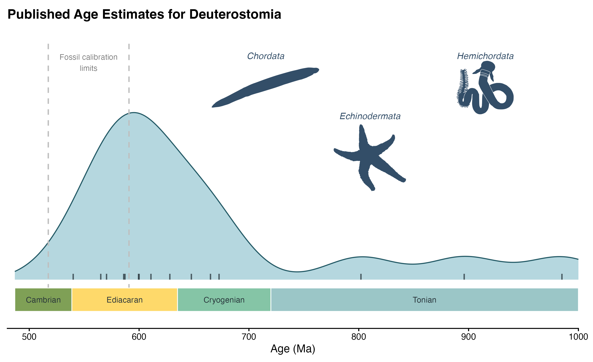

# Outgroup & root calibrations

We primarily focus here on the well-constrained ages discussed by [Benton et al. (2015)](http://palaeo-electronica.org/content/fc-1) and [Carlisle et al. (2024)](https://doi.org/10.1126/sciadv.adp7161).

### Calibrations:

**Node 582:** Crown Deuterostomia | 590.8 - 517.32 Ma\
**Node calibrated:** Last common ancestor of the clade encompassing chordates, echinoderms and hemichordates (when monophyletic)\
**Fossil taxon:** Chengjiang fossils such as _Haikouichthys ercaicunensis_ (HZ-f-12-127, Yunnan Institute of Geological Sciences, Kunming, China) ([Shu et al. 2010](https://royalsocietypublishing.org/doi/abs/10.1098/rspb.2009.0646)).\
**Minimum age:** The age of the Chengjiang biota has been determined through CA-ID-TIMS U-Pb dating, yielding an age of 518.03 Ma ± 0.69/0.71 Myr and a minimum calibration age of 517.32 Ma ([Yang et al. 2018](https://doi.org/10.1144/jgs2017-103)).\
**Minimum justification:** _Haikouichthys_ is widely accepted as at least a crown-chordate and possibly a crown-vertebrate, on the basis of its branchial structures, myomeres, and a notochord ([Shu et al. 2010](https://royalsocietypublishing.org/doi/abs/10.1098/rspb.2009.0646); [Gabbott et al. 2016](https://royalsocietypublishing.org/doi/abs/10.1098/rspb.2016.1151)).\
**Maximum age:** Weng’an Biota, 590.8 Ma ([Yang et al. 2021](https://doi.org/10.1126/sciadv.abi9643)). Yang et al. date the biota based on Re-Os data to 587.2 Ma ±3.6 Myr, yielding a maximum age constraint of 590.8 Ma.\
**Maximum justification:** The Weng’an Biota yields exceptionally preserved macrofossils of algae but nothing that can definitively be placed into crown Metazoa. Embryo-like fossils preserved here have been suggested to be total group metazoans ([Yin et al. 2022](https://doi.org/10.1098/rstb.2021.0032)), but this is still uncertain, and others have suggested they are non-metazoan holozoans ([Huldtgren, et al. 2011](https://www.science.org/doi/abs/10.1126/science.1209537)).\
**Discussion:** Isolated pelmatozoan columnals with characteristic morphology and stereom structure of the echinoderm total group have been found, however they are dated to 515.5 Ma and are therefore younger than _Haikouichthys_ ([Swalla and Smith 2008](https://royalsocietypublishing.org/doi/abs/10.1098/rstb.2007.2246); [Clausen and Smith 2008](https://www.cambridge.org/core/journals/journal-of-paleontology/article/abs/stem-structure-and-evolution-in-the-earliest-pelmatozoan-echinoderms/2F53133C923A5FC745C94E99C98503F4)). The Lantian Biota also has extensive macrofossils without any definitive metazoans, but it is older than the Weng’an Biota ([Yang et al. 2021](https://doi.org/10.1126/sciadv.abi9643)), making the Weng’an a more reasonable choice.

---

**Node 1161:** Crown Ambulacraria | 590.8 - 515.5 Ma\
**Node calibrated:** Last common ancestor of the clade encompassing Hemichordata and Echinodermata.\
**Fossil taxon:** Isolated pelmatozoan columnals (BMNH EE6828-EE6846, Natural History Museum, London, UK).\
**Minimum age:** 515.5 Ma, from the Micmacca Breccia, which encompasses the upper part of the _Cephalopyge notabilis_ Biozone, the _Ornamentaspis frequens_ Biozone and the lower part of the _Kymataspis arenosa_ Biozone, which has been dated to the latest Atdabanian of 517.0 Ma ± 1.5 Myr, or 515.5 ma ([Benton et al. 2015](http://palaeo-electronica.org/content/fc-1)).\
**Maximum age:** Weng’an Biota, 590.8 Ma ([Yang et al. 2021](https://doi.org/10.1126/sciadv.abi9643)). Yang et al. date the biota based on Re-Os data to 587.2 Ma ±3.6 Myr, yielding a maximum age constraint of 590.8 Ma.\
**Minimum justification:** The isolated pelmatzoan columnals have characteristic morphology and stereom structure of the Echinodermata total group ([Benton et al. 2015](http://palaeo-electronica.org/content/fc-1); [Swalla and Smith 2008](https://royalsocietypublishing.org/doi/abs/10.1098/rstb.2007.2246); [Clausen and Smith 2008](https://www.cambridge.org/core/journals/journal-of-paleontology/article/abs/stem-structure-and-evolution-in-the-earliest-pelmatozoan-echinoderms/2F53133C923A5FC745C94E99C98503F4)).\
**Maximum justification:** The Weng’an Biota yields exceptionally preserved macrofossils of algae but nothing that can definitively be placed into crown Metazoa. Embryo-like fossils preserved here have been suggested to be total group metazoans ([Yin et al. 2022](https://doi.org/10.1098/rstb.2021.0032)), but this is still uncertain, and others have suggested they are non-metazoan holozoans ([Huldtgren, et al. 2011](https://www.science.org/doi/abs/10.1126/science.1209537)).

---

**Node 583:** Crown Chordata | 590.8 - 517.32 Ma\
**Node calibrated:** Last common ancestor of the clade encompassing vertebrates, tunicates, and cephalochordates.\
**Fossil taxon:** Chengjiang fossils such as _Haikouichthys ercaicunensis_ (HZ-f-12-127, Yunnan Institute of Geological Sciences, Kunming, China) ([Shu et al. 2010](https://royalsocietypublishing.org/doi/abs/10.1098/rspb.2009.0646)).\
**Minimum age:** The age of the Chengjiang biota has been determined through CA-ID-TIMS U-Pb dating, yielding an age of 518.03 Ma ± 0.69/0.71 Myr and a minimum calibration age of 517.32 Ma ([Yang et al. 2018](https://www.lyellcollection.org/doi/abs/10.1144/jgs2017-103)).\
**Minimum justification:** _Haikouichthys_ is widely accepted as at least a crown-chordate and possibly a crown-vertebrate, on the basis of its branchial structures, myomeres, and a notochord ([Shu et al. 2010](https://royalsocietypublishing.org/doi/abs/10.1098/rspb.2009.0646); [Gabbott et al. 2016](https://royalsocietypublishing.org/doi/abs/10.1098/rspb.2016.1151)).\
**Maximum age:** Weng’an Biota, 590.8 Ma ([Yang et al. 2021](https://doi.org/10.1126/sciadv.abi9643)). Yang et al. date the biota based on Re-Os data to 587.2 Ma ±3.6 Myr, yielding a maximum age constraint of 590.8 Ma.\
**Maximum justification:** The Weng’an Biota yields exceptionally preserved macrofossils of algae but nothing that can definitively be placed into crown Metazoa. Embryo-like fossils preserved here have been suggested to be total group metazoans ([Yin et al. 2022](https://doi.org/10.1098/rstb.2021.0032)), but this is still uncertain, and others have suggested they are non-metazoan holozoans ([Huldtgren, et al. 2011](https://www.science.org/doi/abs/10.1126/science.1209537)).\
**Discussion:** The Lantian Biota also has extensive macrofossils without any definitive metazoans, but it is older than the Weng’an Biota ([Yang et al. 2021](https://doi.org/10.1126/sciadv.abi9643)), making the Weng’an a more reasonable choice.

---

**Node 584:** Crown Olfactores | 590.8 - 517.32 Ma\
**Node calibrated:** Last common ancestor of the clade encompassing tunicates and Vertebrata-Craniata.\
**Fossil taxon:** Chengjiang fossils such as _Haikouichthys ercaicunensis_ (HZ-f-12-127, Yunnan Institute of Geological Sciences, Kunming, China; [Shu et al. 2010](https://royalsocietypublishing.org/doi/abs/10.1098/rspb.2009.0646).\
**Minimum age:** The age of the Chengjiang biota has been determined through CA-ID-TIMS U-Pb dating, yielding an age of 518.03 Ma ± 0.69/0.71 Myr and a minimum calibration age of 517.32 Ma ([Yang et al. 2018](https://www.lyellcollection.org/doi/abs/10.1144/jgs2017-103)).\
**Minimum justification:** _Haikouichthys_ is widely accepted as at least a crown-chordate and possibly a crown-vertebrate, on the basis of its branchial structures, myomeres, and a notochord ([Shu et al. 2010](https://royalsocietypublishing.org/doi/abs/10.1098/rspb.2009.0646); [Gabbott et al. 2016](https://royalsocietypublishing.org/doi/abs/10.1098/rspb.2016.1151)).\
**Maximum age:** Weng’an Biota, 590.8 Ma ([Yang et al. 2021](https://doi.org/10.1126/sciadv.abi9643)). Yang et al. date the biota based on Re-Os data to 587.2 Ma ±3.6 Myr, yielding a maximum age constraint of 590.8 Ma.\
**Maximum justification:** The Weng’an Biota yields exceptionally preserved macrofossils of algae but nothing that can definitively be placed into crown Metazoa. Embryo-like fossils preserved here have been suggested to be total group metazoans ([Yin et al. 2022](https://doi.org/10.1098/rstb.2021.0032)), but this is still uncertain, and others have suggested they are non-metazoan holozoans ([Huldtgren, et al. 2011](https://www.science.org/doi/abs/10.1126/science.1209537)).\
**Discussion:** The Lantian Biota also has extensive macrofossils without any definitive metazoans, but it is older than the Weng’an Biota ([Yang et al. 2021](https://doi.org/10.1126/sciadv.abi9643)), making the Weng’an a more reasonable choice.

### Likelihood checkpoints

We gathered 15 studies supporting a likelihood checkpoint for the root (Deuterostomia) published between 1998 and 2024 (deuterostomia_ages.csv). As discussed by previous authors ([Cunningham et al. 2017](https://doi.org/10.1002/bies.201600120)), early disagreements between the fossil record and molecular divergence times have narrowed with more recent discoveries, interpretations, and methods. As noted above, we rely primarily on the recent framework of [Benton et al. (2015)](http://palaeo-electronica.org/content/fc-1) and [Carlisle et al. (2024)](https://doi.org/10.1126/sciadv.adp7161) to interpret the Cambrian and Ediacaran fossil record and derive well-constrained ages for the emergence of deuterostomes between 517–591Ma. Of the 15 studies evaluated here, only 5 fall within that interval and the modal estimate is ~600Ma. However, most of the older ages are from older studies, before the recent movement towards reconciliation. Consequently, we are confident in the younger and narrower bounds used here.

## References

Benton, M.J., Donoghue, P.C., Asher, R.J., Friedman, M., Near, T.J. and Vinther, J., 2015. Constraints on the timescale of animal evolutionary history. Palaeontologia Electronica 18.1.1FC; 1-106.

Carlisle E et al. 2024, Ediacaran origin and Ediacaran-Cambrian diversification of Metazoa.Sci. Adv. 10, eadp7161(2024).

Clausen, S. and Smith, A.B., 2008. Stem structure and evolution in the earliest pelmatozoan echinoderms. Journal of Paleontology, 82(4), pp.737-748.

Cunningham, J.A., Liu, A.G., Bengtson, S. and Donoghue, P.C.J. (2017), The origin of animals: Can molecular clocks and the fossil record be reconciled?. BioEssays, 39: 1-12 e201600120.

Gabbott, S.E., Donoghue, P.C., Sansom, R.S., Vinther, J., Dolocan, A. and Purnell, M.A., 2016. Pigmented anatomy in Carboniferous cyclostomes and the evolution of the vertebrate eye. Proceedings of the Royal Society B: Biological Sciences, 283(1836), p.20161151.

Huldtgren, T., Cunningham, J.A., Yin, C., Stampanoni, M., Marone, F., Donoghue, P.C. and Bengtson, S., 2011. Fossilized nuclei and germination structures identify Ediacaran “animal embryos” as encysting protists. Science, 334(6063), pp.1696-1699.

Shu, D.G., Conway Morris, S., Zhang, Z.F. and Han, J., 2010. The earliest history of the deuterostomes: the importance of the Chengjiang Fossil-Lagerstätte. Proceedings of the Royal Society B: Biological Sciences, 277(1679), pp.165-174.

Swalla, B.J. and Smith, A.B., 2008. Deciphering deuterostome phylogeny: molecular, morphological and palaeontological perspectives. Philosophical Transactions of the Royal Society B: Biological Sciences, 363(1496), pp.1557-1568.

Yin Z, Weichen Sun, Pengju Liu, Junyuan Chen, David J. Bottjer, Jinhua Li, Maoyan Zhu. 2022. Diverse and complex developmental mechanisms of early Ediacaran embryo-like fossils from the Weng'an Biota, southwest China. Philos Trans R Soc Lond B Biol Sci 28 March 2022; 377 (1847): 20210032.

Yang, C., Li, X.H., Zhu, M., Condon, D.J. and Chen, J., 2018. Geochronological constraint on the Cambrian Chengjiang biota, South China. Journal of the Geological Society, 175(4), pp.659-666.

Yang C. et al. 2021, The tempo of Ediacaran evolution. Sci. Adv. 7, eabi9643 (2021).
