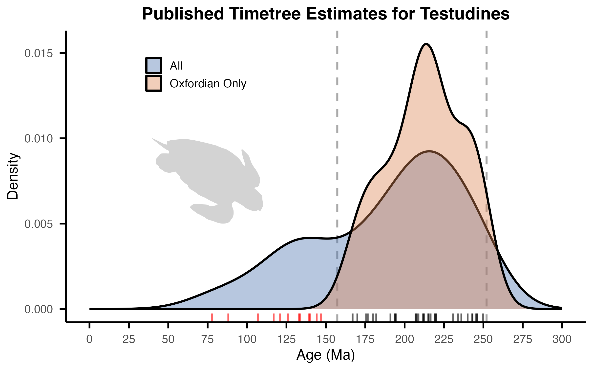

# Turtle calibrations

Turtles have a dense and detailed fossil record that has made them particularly amenable to time-calibrated phylogenetic analyses using taxonomically-justified fossil constraints, which were reviewed in detail for the group by [Joyce et al. (2013)](https://doi.org/10.1666/12-149). That study provided 22 well-constrained node ages to date the turtle tree, which were corroborated and partially updated by [Selvatti et al. (2023)](https://doi.org/10.1016/j.ympev.2023.107773). Given our modest sampling of turtles, only 9 of the 22 constraints are applicable here, which we list below as our primary calibrations. For all ages, material, and taxa referenced below, the synapomorphies, stratigraphy, and material are summarized by [Joyce et al. (2013)](https://doi.org/10.1666/12-149) and [Selvatti et al. (2023)](https://doi.org/10.1016/j.ympev.2023.107773), from which all data are derived unless otherwise stated. [Joyce et al. (2013)](https://doi.org/10.1666/12-149) note the presence of a great deal of additional material that may be better characterized phylogenetically and stratigraphically in the future, yielding older and more precise estimates for many nodes.

CAL identifiers refer to records in the [master calibration list](../master_calibrations.csv). Tree mappings give the corresponding node numbers in [ROADIES v0.0.0](../../trees/roadies_v1.1.16b.numbers.nwk) (`roadies_v1.1.16b`) and [ASTRAL v0.1.1](../../trees/astralpro.l6p1.numbers.nwk) (`astralpro.l6p1`).

### Calibrations:

**CAL074:** Testudines | 157.3–252.0Ma\
**Tree mapping:** ROADIES node 732; ASTRAL node 976\
**Node calibrated:** Last common ancestor of the clade encompassing all extant turtles: Chelidae (_Myuchelys georgesi_) + Cheloniidae (_Lepidochelys kempii_)\
**Fossil taxa:** †_Notoemys oxfordiensis_ (MNHNCu P 3209)\
**Minimum age:** 157.3Ma\
**Minimum justification:** As per [Cadena and Joyce (2015)](https://doi.org/10.3374/014.056.0101), the oldest crown testudine from the Viñales locality, Pinar del Río Province, Cuba; Jagua Vieja Member, Jagua Formation, Oxfordian (154.8–161.5Ma), Late Jurassic ([de la Fuente and Iturralde-Vinent 2001](https://www.cambridge.org/core/journals/journal-of-paleontology/article/new-pleurodiran-turtle-from-the-jagua-formation-oxfordian-of-western-cuba/33E57BAE07B114094E5C322E1D4F190F)).\
**Maximum age:** 252.0Ma\
**Maximum justification:** Maximum age based on the lower boundary of the Triassic, a conservative boundary based on the lack of any putative crown turtles from the Permian.\
**Discussion:** The minimum age of 157.3Ma for crown Testudines is generally used as a maximum age for other calibrations in the absence of more precise constraints. As noted by [Selvatti et al. (2023)](https://doi.org/10.1016/j.ympev.2023.107773), †_Yehguia tatsuensis_ originates from the same horizon (Oxfordian), representing a similar prior age for this node.

---

**CAL075:** Pleurodira | 125.0–157.3Ma\
**Tree mapping:** ROADIES node 747; ASTRAL node 977\
**Node calibrated:** Last common ancestor of the clade encompassing all extant pleurodirans: Chelidae (_Myuchelys georgesi_) + Podocnemidae (_Podocnemis expansa_)\
**Fossil taxa:** †_Atolchelys lepida_ (UERJ.MC 2)\
**Minimum age:** 125.0Ma\
**Minimum justification:** Based on the oldest crown pleurodiran ([Romano et al. 2014](https://royalsocietypublishing.org/doi/abs/10.1098/rsbl.2014.0290)) from the Morro do Chaves Formation, Sergipe-Alagoas Basin, Brazil from the Barremian of the Cretaceous (121.4–125.77Ma).\
**Maximum age:** 157.3Ma\
**Maximum justification:** Maximum age based on the oldest pan-pleurodiran †_Notoemys oxfordiensis_ from the Oxfordian of the Jurassic (154.8–161.5Ma).\
**Discussion:** [Selvatti et al. (2023)](https://doi.org/10.1016/j.ympev.2023.107773) assign this fossil to the less-inclusive clade Pelomedusoides, but our taxon sampling is not detailed enough to capture this crown group. As a result, we calibrate its stem age instead, which is equivalent to the crown group Pleurodira.\
**Notes:** For a future constraint implemented under expanded taxon sampling, see the Pelomedusoides calibration below.

---

**CAL076:** Cryptodira | 157.3–201.4Ma\
**Tree mapping:** ROADIES node 733; ASTRAL node 978\
**Node calibrated:** Last common ancestor of the clade encompassing all extant cryptodirans: Carettochelyidae (_Carettochelys insculpta_) + Cheloniidae (_Lepidochelys kempii_)\
**Fossil taxa:** †_Yehguia tatsuensis_ (IVPP-V996)\
**Minimum age:** 157.3Ma\
**Minimum justification:** Based on the oldest crown cryptodiran from the Oxfordian of the Jurassic (154.8–161.5Ma), from Chongqing, Sichuan Province, China, probably in the Upper Jurassic Shaximiao Formation ([Danilov and Parham 2006](https://doi.org/10.1671/0272-4634(2006)26[573:aroptf]2.0.co;2), [Tong et al. 2014](https://www.cambridge.org/core/journals/geological-magazine/article/revision-of-sinaspideretes-wimani-young-chow-1953-testudines-cryptodira-trionychoidae-from-the-jurassic-of-the-sichuan-basin-china/69FA3F1252476D48D9B9F171B5993E21)).\
**Maximum age:** 201.4Ma\
**Maximum justification:** Maximum age based on the end of the Triassic, a conservative boundary based on the lack of any putative crown cryptodirans from the Triassic.\
**Discussion:** Also serves as a minimum age for Testudines.

---

**CAL077:** Durocryptodira | 88.6–157.3Ma\
**Tree mapping:** ROADIES node 734; ASTRAL node 979\
**Node calibrated:** Last common ancestor of the clade encompassing all extant durocryptodirans: Emydidae (_Malaclemys terrapin_) + Cheloniidae (_Lepidochelys kempii_)\
**Fossil taxa:** †_Lindholmemys elegans_ (CCMGE 34/12175)\
**Minimum age:** 88.6Ma\
**Minimum justification:** Based on the oldest crown durocryptodiran, likely stem Testudinoidea ([Danilov and Parham 2005](https://www.tandfonline.com/doi/abs/10.1671/0272-4634(2005)025%5B0784%3AAROTRO%5D2.0.CO%3B2)), from the Turonian Bissekty Formation of Uzbekistan of the Cretaceous (89.8–93.9Ma).\
**Maximum age:** 157.3Ma\
**Maximum justification:** As with several remaining calibrations, based on the minimum age of crown Testudines.\
**Discussion:** Previous phylogenetic analyses used chimeric specimens ([Shaffer et al. 1997](https://academic.oup.com/sysbio/article-abstract/46/2/235/1712833)), but the referenced material was placed on the testudinoid stem when coded directly ([Danilov and Parham 2005](https://www.tandfonline.com/doi/abs/10.1671/0272-4634(2005)025%5B0784%3AAROTRO%5D2.0.CO%3B2)).

---

**CAL078:** Testuguria | 50.3–157.3Ma\
**Tree mapping:** ROADIES node 744; ASTRAL node 982\
**Node calibrated:** Last common ancestor of the clade encompassing all extant testugurians: Testudinidae (_Gopherus flavomarginatus_) + Geoemydidae (_Pangshura tecta_)\
**Fossil taxa:** †_Hadrianus majusculus_ (YPM 2793)\
**Minimum age:** 50.3Ma\
**Minimum justification:** Based on the oldest crown testugurian, likely stem Testudinidae ([Lichtig et al. 2021](https://books.google.com/books?hl=en&lr=&id=DLoxEAAAQBAJ&oi=fnd&pg=PA161&dq=hadrianus+majusculus&ots=a0qnHakZEK&sig=0ee2WuL1HwUwKPRxiE6z7lKv8ns)), from the Eocene Wasatchian badlands of New Mexico (50.3–55.4Ma).\
**Maximum age:** 157.3Ma\
**Maximum justification:** As with several remaining calibrations, based on the minimum age of crown Testudines.\
**Discussion:** Some uncertainty exists as to the precise geographic and stratigraphic localities of material associated with this taxon [(Joyce et al. 2013)](https://doi.org/10.1666/12-149).

---

**CAL079:** Emydidae | 32.0–157.3Ma\
**Tree mapping:** ROADIES node 746; ASTRAL node 981\
**Node calibrated:** Last common ancestor of the clade encompassing all extant emydids: _Malaclemys terrapin_ + _Emys orbicularis_\
**Fossil taxa:** †_Chrysemys antiqua_ (SDSM 2754)\
**Minimum age:** 32.0Ma\
**Minimum justification:** Based on the oldest crown emydid [(Joyce et al. 2013)](https://doi.org/10.1666/12-149) from SDSM locality V271 within the Orellan Protoceras channels of the Oligocene White River Group (32.0–33.7Ma) of South Dakota.\
**Maximum age:** 157.3Ma\
**Maximum justification:** As with several remaining calibrations, based on the minimum age of crown Testudines.\
**Discussion:** A range of material exists for this taxon ([Hutchison 1996](https://doi.org/10.1017/CBO9780511665431.017)).

---

**CAL080:** Americhelydia | 70.0–157.3Ma\
**Tree mapping:** ROADIES node 735; ASTRAL node 984\
**Node calibrated:** Last common ancestor of the clade encompassing all extant americhelyids: Chelydroidea (_Macrochelys suwanniensis_: Chelydridae) + Chelonioidea (_Lepidochelys kempii_: Cheloniidae)\
**Fossil taxa:** †_Toxochelys latiremis_ (ROM 28563)\
**Minimum age:** 70.0Ma\
**Minimum justification:** Based on the oldest crown americhelyid, likely stem Chelonioidea ([Nicholls 1988](https://www.tandfonline.com/doi/abs/10.1080/02724634.1988.10011696)), from the Niobrara Chalk Formation of the Campanian, upper Cretaceous (72.2–83.6Ma) of Kansas.\
**Maximum age:** 157.3Ma\
**Maximum justification:** As with several remaining calibrations, based on the minimum age of crown Testudines.\
**Discussion:** The stratigraphic placement of the referenced specimen is uncertain and may actually be slightly older ([Joyce et al. 2013](https://doi.org/10.1666/12-149)).

---

**CAL081:** Chelydroidea | 70.0–157.3Ma\
**Tree mapping:** ROADIES node 742; ASTRAL node 985\
**Node calibrated:** Last common ancestor of the clade encompassing all extant chelydroids: Chelydridae (_Macrochelys suwanniensis_) + Kinosternidae (_Sternotherus odoratus_)\
**Fossil taxa:** Chelydridae indet. (SEPCP 9/493)\
**Minimum age:** 70.0Ma\
**Minimum justification:** Based on the oldest crown chelydroid material, likely stem Chelydridae ([Brinkman and de la Rosa 2006](https://www.researchgate.net/publication/237805222_Nonmarine_turtles_from_the_Cerro_del_Pueblo_Formation_Campanian_Coahuila_State_Mexico)), from the Cerro del Pueblo Formation of the Campanian (72.2–83.6Ma), upper Cretaceous of Mexico.\
**Maximum age:** 157.3Ma\
**Maximum justification:** As with several remaining calibrations, based on the minimum age of crown Testudines.\
**Discussion:** A range of apparent chelydrid material exists from the Mesozoic of North America (summarized by [Joyce et al. 2013](https://doi.org/10.1666/12-149)), but only the referenced specimen shows clear synapomorphies.

---

**CAL082:** Chelonioidea | 48.4–157.3Ma\
**Tree mapping:** ROADIES node 736; ASTRAL node 986\
**Node calibrated:** Last common ancestor of the clade encompassing all extant chelonioids: Dermochelyidae (_Dermochelys coriacea_) + Cheloniidae (_Lepidochelys kempii_)\
**Fossil taxa:** †_Eosphargis breineri_ (FM uncat.)\
**Minimum age:** 48.4Ma\
**Minimum justification:** Based on the oldest known chelonioid, likely stem Dermochelyidae ([Hirayama 1994](https://onlinelibrary.wiley.com/doi/abs/10.1111/j.1440-1738.1994.tb00116.x), [Wood et al. 1996](https://chelonian.org/wp-content/uploads/file/CCB%20Vol%202%20No%202%20(1996)/Wood_etal_1996.pdf)), from the Ypresian Fur Formation of the Eocene (48.07–56.0Ma) of Denmark.\
**Maximum age:** 157.3Ma\
**Maximum justification:** As with several remaining calibrations, based on the minimum age of crown Testudines.\
**Discussion:** A range of material likely assignable to the stem of Dermochelyidae exists from the Paleocene and Eocene along with a number of other †_Eosphargis_ specimens (summarized by [Joyce et al. 2013](https://doi.org/10.1666/12-149)), but they remain to be properly characterized phylogenetically and stratigraphically.

### Future calibrations for larger tree

**CAL $X:** Pelomedusoides | 125.0–157.3Ma\
**Node calibrated:** Last common ancestor of the clade encompassing all extant pelomedusoids: Podocnemidae (_Podocnemis expansa_) + Pelomedusidae (_Pelomedusa somalica_)\
**Fossil taxa:** †_Atolchelys lepida_ (UERJ.MC 2)\
**Minimum age:** 125.0Ma\
**Minimum justification:** Based on the oldest-known crown pelomedusoid ([Romano et al. 2014](https://royalsocietypublishing.org/doi/abs/10.1098/rsbl.2014.0290)) from the Morro do Chaves Formation, Sergipe-Alagoas Basin, Brazil from the Barremian of the Cretaceous (121.4–125.77Ma).\
**Maximum age:** 157.3Ma\
**Maximum justification:** Maximum age based on the oldest pan-pleurodiran †_Notoemys oxfordiensis_ from the Oxfordian of the Jurassic (154.8–161.5Ma).\
**Discussion:** As per [Selvatti et al. (2023)](https://doi.org/10.1016/j.ympev.2023.107773), †_Atolchelys_ exhibits "the typical 11 plastron bones of most pleurodires, a reduced pair of mesoplastra, and no fontanelles, as well as exclusive cranial characteristics diagnostic to the Pan-Podocnemididae clade."

---

**CAL $X:** Trionychia | 124.0–177.6Ma\
**Node calibrated:** Last common ancestor of the clade encompassing all extant trionychians: Carettochelyidae (_Carettochelys insculpta_) + Trionychidae (_Chitra chitra_)\
**Fossil taxa:** Pan-Trionychidae indet. (FPDM V-127)\
**Minimum age:** 124.0Ma\
**Minimum justification:** A stem trionychid diagnosed by fibrous layers integrated into the shell bones, from the Cretaceous (Barremian) Kitadani Formation (Tetori Group) of Japan (see [Joyce et al. (2013)](https://doi.org/10.1666/12-149)). As noted by Joyce et al. ([2013](https://doi.org/10.1666/12-149)), unambiguous carettochelyid fossils from the "pre-Aptian" Sao Khua Formation of Thailand also support a Barremian minimum age for this clade.\
**Maximum age:** 177.6Ma\
**Maximum justification:** As per [Joyce et al. (2013)](https://doi.org/10.1666/12-149), the late Jurassic or early Cretaceous †_Sinaspideretes wimani_ also represents a possible crown trionychian, though not one that can reliably be used to constrain the minimum age. As a result, given the abundance of middle Jurassic turtles without any putative trionychians, a soft maximum age at the early–middle Jurassic boundary is a conservative compromise. They note that other authors reject this placement and assigned a much younger early Cretaceous (Hauterivian) maximum age of 131.5Ma ([Lourenço et al. 2012](https://doi.org/10.1016/j.ympev.2011.10.022)), though this has not been supported by recent estimates such as Selvatti et al. ([2023](https://doi.org/10.1016/j.ympev.2023.107773)).\
**Discussion:** This calibration was considered congruent and not modified between Joyce et al. ([2013](https://doi.org/10.1666/12-149)) and Selvatti et al. ([2023](https://doi.org/10.1016/j.ympev.2023.107773)).

### Likelihood Checkpoints:

We located 46 age estimates from 28 studies for a likelihood checkpoint on Testudines. They exhibit a very broad range from 77.8–249.8Ma with a median of 207.0Ma and a kernel-density mode of 215.5Ma, excluding outliers (1.5 * IQR). The bulk of published estimates are within our calibration range of 157.3–252.0Ma, and none predate the lower boundary of the Triassic. Most of the post-Oxfordian estimates had highly incomplete taxon sampling or used inaccurate fossil calibrations prior to the reviews of [Joyce et al. (2013)](https://doi.org/10.1666/12-149) and [Selvatti et al. (2023)](https://doi.org/10.1016/j.ympev.2023.107773), which we highlight for exclusion. The median and mode for the pre-Oxfordian estimates are both 213.7Ma. The figure summarizes the [compiled age estimates](testudines_timetrees.csv) and is generated with the [plotting script](testudines_timetrees.R).

## References

Brinkman, D. and de la Rosa, R.R., 2006. Nonmarine turtles from the Cerro del Pueblo Formation (Campanian), Coahuila State, Mexico. New Mexico Museum of Natural History and Science Bulletin, 35, pp.229-233.

Cadena, E., Joyce, W.G., 2015. A review of the fossil record of turtles of the clades Platychelyidae and Dortokidae. Bulletin of the Peabody Museum of Natural History 56, 3–20.

Danilov, I.G. and Parham, J.F., 2005. A reassessment of the referral of an isolated skull from the Late Cretaceous of Uzbekistan to the stem-testudinoid turtle genus Lindholmemys. Journal of vertebrate Paleontology, 25(4), pp.784-791.

Danilov, I.G., Parham, J.F., 2006. A redescription of ‘Plesiochelys’ tatsuensis from the Late Jurassic of China, with comments on the antiquity of the crown clade Cryptodira. J Vertebr Paleontol 26, 573–580.

de la Fuente, M, & Iturralde-Vinent, M. 2001. A new pleurodiran turtle from the Jagua Formation (Oxfordian) of western Cuba. Journal of Paleontology, 75(4), 860-869.

Fujita, M. 2003. Geological age and correlation of the vertebrate-bearing horizons in the Tetori Group. Memoir of the Fukui Prefectural Dinosaur Museum, 2:3–14

Hirayama, R., 1994. Phylogenetic systematics of chelonioid sea turtles. Island Arc, 3(4), pp.270-284.

Hutchison JH. Testudines. In: Prothero DR, Emry RJ, eds. The Terrestrial Eocene-Oligocene Transition in North America. Cambridge University Press; 1996:337-353.

Joyce, W.G., Parham, J.F., Lyson, T.R., Warnock, R.C. and Donoghue, P.C., 2013. A divergence dating analysis of turtles using fossil calibrations: an example of best practices. Journal of Paleontology, 87(4), pp.612-634.

Lichtig, A.J., Lucas, S.G. and Jasinski, S.E., 2021. Complete specimens of the Eocene testudinoid turtles Echmatemys and Hadrianus and the North American origin of tortoises. New Mexico Museum of Natural History and Science Bulletin, 82, pp.161-176.

Lourenço, J.M., Claude, J., Galtier, N. and Chiari, Y., 2012. Dating cryptodiran nodes: origin and diversification of the turtle superfamily Testudinoidea. Molecular Phylogenetics and Evolution, 62(1), pp.496-507.

Nakajima, Y., I. G. Danilov, and R. Hirayama. 2009. Plywood-like structures in costal bones of mid- to late Cretaceous trionychids from Asia, p. 128. In Gaffney Turtle Symposium, Abstract Volume. Royal Tyrrell Museum of Palaeontology, Drumheller.

Nicholls, E.L., 1988. New material of Toxochelys latiremis Cope, and a revision of the genus Toxochelys (Testvoines, Chelonioidea). Journal of Vertebrate Paleontology, 8(2), pp.181-187.

Romano, P.S., Gallo, V., Ramos, R.R. and Antonioli, L., 2014. Atolchelys lepida, a new side-necked turtle from the Early Cretaceous of Brazil and the age of crown Pleurodira. Biology Letters, 10(7), p.20140290.

Selvatti, A.P., Moreira, F.R.R., Carvalho, D.C., Prosdocimi, F., de Moraes Russo, C.A. and Junqueira, A.C.M., 2023. Phylogenomics reconciles molecular data with the rich fossil record on the origin of living turtles. Molecular Phylogenetics and Evolution, 183, p.107773.

Shaffer, H.B., Meylan, P. and McKnight, M.L., 1997. Tests of turtle phylogeny: molecular, morphological, and paleontological approaches. Systematic Biology, 46(2), pp.235-268.

Tong, H., Li, L. and Ouyang, H., 2014. A revision of Sinaspideretes wimani Young & Chow, 1953 (Testudines: Cryptodira: Trionychoidae) from the Jurassic of the Sichuan Basin, China. Geological Magazine, 151(4), pp.600-610.

Wood, R.C., Johnson-Gove, J., Gaffney, E.S. and Maley, K.F., 1996. Evolution and phylogeny of the leatherback turtles (Dermochelyidae), with descriptions of new fossil taxa. Chelonian Conservation and Biology, 2, pp.266-286.
