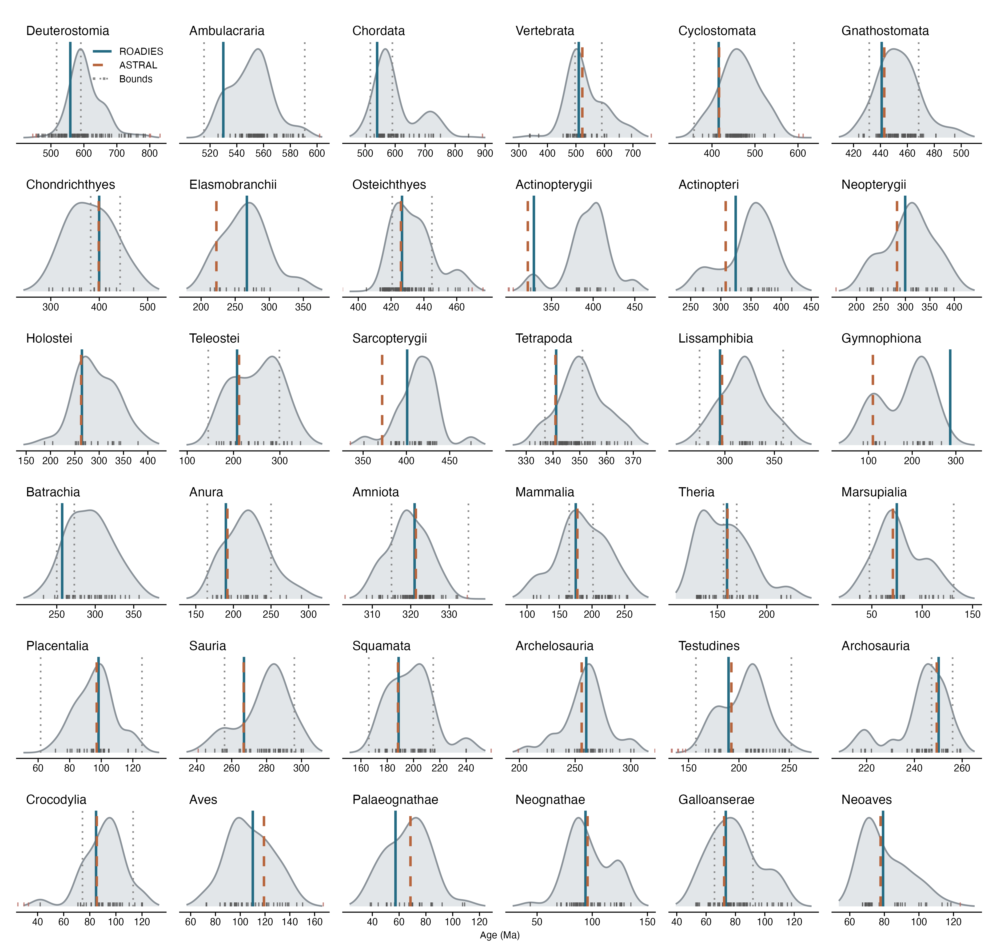

# Likelihood checkpoints

These figures compare published divergence times with the updated independent [MD-CAT trees](../dating/README.md) and fossil calibration bounds. Each study, identified by its DOI, has equal total weight, divided among its estimates. Outliers beyond 1.5 times the study-weighted interquartile range are marked in red and omitted from the curves and summaries; each remaining study contributes equal total weight to those summaries.

Density smoothing uses Silverman's rule adapted to the study-weighted spread and the number of studies.

See the detailed figures for [outgroups](../calibrations/outgroups/deuterostomia.md#likelihood-checkpoints), [vertebrates](../calibrations/vertebrates/vertebrata.md#likelihood-checkpoints), [fishes](../calibrations/fishes/fishes.md#likelihood-checkpoints), [tetrapods](../calibrations/tetrapods/tetrapoda.md#likelihood-checkpoints), [amphibians](../calibrations/amphibia/amphibia.md#likelihood-checkpoints), [squamates](../calibrations/squamata/squamata.md#likelihood-checkpoints), [turtles](../calibrations/turtles/testudines.md#likelihood-checkpoints), [crocodilians](../calibrations/crocodylia/crocodylia.md#likelihood-checkpoints), [mammals](../calibrations/mammals/mammalia.md#likelihood-checkpoints), and [birds](../calibrations/birds/aves.md#likelihood-checkpoints).

The [estimates and citations](checkpoint_estimates.csv) are drawn from [TimeTree](https://timetree.org/) and manually updated and verified. The combined figure is also available as a [PDF](checkpoints_summary.pdf).
