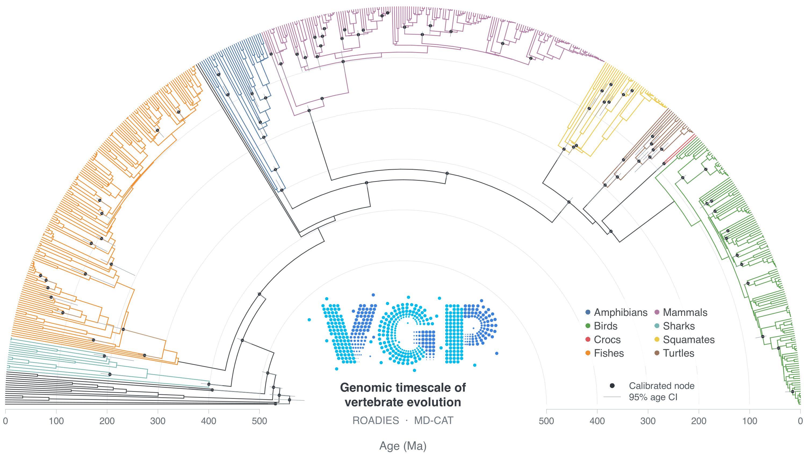

# VGP Phase I dated trees

We dated the ROADIES v0.0.0 and ASTRAL v0.1.1 trees using [**MD-CAT 1.1.15**](mdcat/README.md), with fossil calibrations assembled by the VGP dating working group. Branch lengths are given in **millions of years (Ma)**. The trees are distributed in [VGP tree-release](https://github.com/VGP/vgp-tree-release). This repository records their calibrations, commands, results, and visualizations. The [calibration documentation](../calibrations/calibrations.md) provides the fossil justifications. The [list](../calibrations/master_calibrations.csv) contains 99 records, with 96 mapped to ROADIES, 91 to ASTRAL, and 88 shared. The [reference-tree documentation](../trees/trees.md) describes the undated topologies, annotations, and APE node-numbering files used by contributors.

## Dated trees

| Reference tree | Analysis | Dated tree (NEXUS) | Node-age table (TSV) | Figure | Release |
| --- | --- | --- | --- | --- | --- |
| ROADIES v0.0.0 | [Command and files](mdcat/roadies_v1.1.16b/README.md) | [Tree](mdcat/roadies_v1.1.16b/roadies_v1.1.16b.independent.fast95.tre) | [Table](mdcat/roadies_v1.1.16b/roadies_v1.1.16b.independent.fast95.tre.tsv) | [PDF](mdcat/roadies_v1.1.16b/roadies_v1.1.16b.independent.fast95.pdf) | [v0.0.0](https://github.com/VGP/vgp-tree-release/tree/master/v0.0.0) |
| ASTRAL v0.1.1 | [Command and files](mdcat/astralpro.l6p1/README.md) | [Tree](mdcat/astralpro.l6p1/astralpro.l6p1.independent.fast95.tre) | [Table](mdcat/astralpro.l6p1/astralpro.l6p1.independent.fast95.tre.tsv) | [PDF](mdcat/astralpro.l6p1/astralpro.l6p1.independent.fast95.pdf) | [v0.1.1](https://github.com/VGP/vgp-tree-release/tree/master/v0.1.1) |

## Exploratory analyses

Earlier [treePL tests](treePL/README.md), including their scripts, configs, and generated results, are retained for reference.
