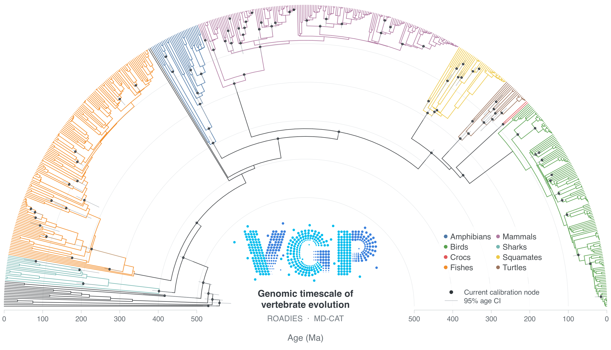
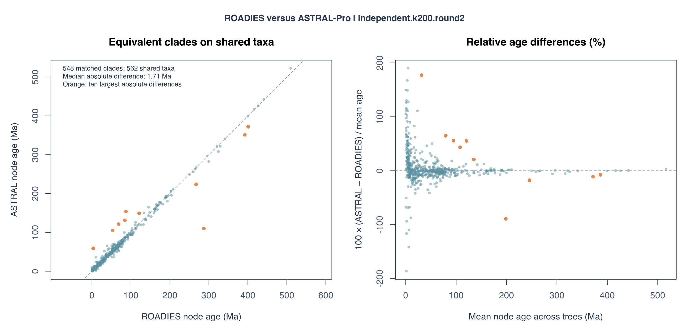

# VGP Phase I dated trees

We dated the ROADIES v0.0.0 and per-species ASTRAL v0.1.1 trees with [MD-CAT](https://github.com/smirarab/MD-Cat). Independent sampling draws each calibration age separately, redrawing incompatible ages. Reported node ages are means across 100 fitted runs, with 95% pooled-percentile intervals calculated from 10,000 confidence-interval replicates. Ages and branch lengths are in **millions of years (Ma)**.

The [calibration documentation](../calibrations/README.md) provides the fossil justifications. The [master list](../calibrations/master_calibrations.csv) contains 108 constraints, with 105 mapped to ROADIES, 100 to ASTRAL, and 97 shared. The [reference-tree documentation](../trees/README.md) describes the topologies, annotations, and APE node-numbering. `round2` denotes the final revision of the 108 fossil calibrations. Earlier configurations were not retained; this repository provides the final version.

## Dated trees

| Reference tree | Tips | Inputs | Independent | Node ages |
| --- | ---: | --- | --- | --- |
| [ROADIES v0.0.0](https://github.com/VGP/vgp-tree-release/tree/master/v0.0.0) | 581 | [Tree](../trees/roadies_v1.1.16b.nwk), [calibrations](mdcat/roadies_v1.1.16b/calibrations.config) | [NEXUS](mdcat/roadies_v1.1.16b/roadies_v1.1.16b.independent.k200.round2.tre), [PDF](mdcat/roadies_v1.1.16b/roadies_v1.1.16b.independent.k200.round2.pdf), [PNG](mdcat/roadies_v1.1.16b/roadies_v1.1.16b.independent.k200.round2.png) | [TSV](mdcat/roadies_v1.1.16b/roadies_v1.1.16b.independent.k200.round2.tre.tsv) |
| [ASTRAL v0.1.1 per-species](https://github.com/VGP/vgp-tree-release/tree/master/v0.1.1) | 563 | [Tree](../trees/astralpro.l6p1.perspecies.tre), [calibrations](mdcat/astralpro.l6p1/calibrations.config) | [NEXUS](mdcat/astralpro.l6p1/astralpro.l6p1.independent.k200.round2.perspecies.tre), [PDF](mdcat/astralpro.l6p1/astralpro.l6p1.independent.k200.round2.perspecies.pdf), [PNG](mdcat/astralpro.l6p1/astralpro.l6p1.independent.k200.round2.perspecies.png) | [TSV](mdcat/astralpro.l6p1/astralpro.l6p1.independent.k200.round2.perspecies.tre.tsv) |



Overview dots mark the calibration nodes, and hairlines show the 95% age intervals. Full-tree PDFs label species and internal nodes, with calibration bounds and age summaries. Node-age tables contain one row per tip or internal node, using APE node numbers. Columns give the mean age (`age`), 95% bounds (`t_lower`, `t_upper`), numbers of fitted runs and confidence-interval replicates, and descendant accessions (`descendant_tips`).

## Node-age comparison

The comparison matches 548 clades among the 562 taxa shared by ROADIES and ASTRAL. The left panel compares their mean node ages against a line of equality. The right panel shows `100 × (ASTRAL − ROADIES) / mean age`; positive values indicate older ASTRAL estimates. Orange points mark the ten largest absolute differences.



The [comparison table](mdcat/node_age_comparison.tsv) lists the paired nodes, ages, differences, and representative tips.

## Analysis commands

Both analyses used MD-CAT 1.1.15 with the full gene counts: 123,141 for ROADIES and 162,228 for ASTRAL. Each analysis used 100 independently sampled calibration sets, 200 rate categories, 100 optimization starts per set, and a maximum of 100 iterations per fit. Each fit contributed 100 confidence-interval replicates.

The calibration configs used for these analyses are provided alongside run manifests for [ROADIES](mdcat/roadies_v1.1.16b/manifest.json) and [ASTRAL](mdcat/astralpro.l6p1/manifest.json). The manifests record input and config hashes, settings, random seeds, and commands. The configs retain their original treePL paths; MD-CAT receives the input tree explicitly through `-i` and reads the calibration constraints from the config specified by `-t`.

The commands below reproduce the recorded analysis settings with paths adapted to the repository root. They require MD-CAT in the Python environment and write results to `results/mdcat`, leaving the released files unchanged. Adjust `--jobs` to control the number of concurrent fits.

```sh
python -m emd.sample \
  -i trees/astralpro.l6p1.perspecies.tre \
  -t dating/mdcat/astralpro.l6p1/calibrations.config \
  -o results/mdcat/astralpro.l6p1.independent.k200.round2.perspecies.tre \
  -l 162228 -k 200 -p 100 -S 100 --maxIter 100 \
  --strategy independent --distribution exponential --max-draws 1000000000 \
  --randSeed 20461102 --min-branch 0.001 --annotate 2 \
  --CI "100 0.025 0.975" --summary mean --format nexus --jobs 10 --threads 1

python -m emd.sample \
  -i trees/roadies_v1.1.16b.nwk \
  -t dating/mdcat/roadies_v1.1.16b/calibrations.config \
  -o results/mdcat/roadies_v1.1.16b.independent.k200.round2.tre \
  -l 123141 -k 200 -p 100 -S 100 --maxIter 100 \
  --strategy independent --distribution exponential --max-draws 1000000000 \
  --randSeed 20461102 --min-branch 0.001 --annotate 2 \
  --CI "100 0.025 0.975" --summary mean --format nexus --jobs 10 --threads 1
```

## Regenerate figures and tables

The [plotting script](mdcat/plot_mdcat.R) updates the independent overview, full-tree PDF, and node-age table for either topology, or the comparison:

```sh
Rscript dating/mdcat/plot_mdcat.R roadies_v1.1.16b
Rscript dating/mdcat/plot_mdcat.R astralpro.l6p1
Rscript dating/mdcat/plot_mdcat.R comparison
```

## Exploratory analyses

[treePL analyses](treePL/README.md) provide exploratory dates, with a standalone optimizer and configs.
