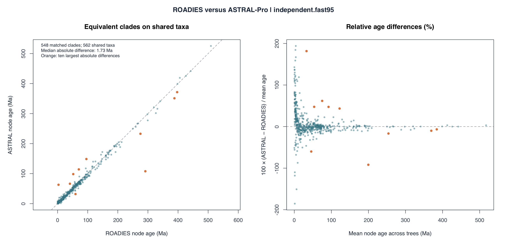

# MD-CAT dating

Analyses used [MD-CAT 1.1.15](https://github.com/smirarab/MD-Cat/blob/deafdab1e657d3e807b5e8203f3ee5189131b0e5/README.md#use-case-4-using-calibration-ranges-with-sampling) with independent calibration sampling and treePL-format configs. Node ages are means across 100 fitted runs, with 95% pooled-percentile intervals from 10,000 CI replicates. Ages and branch lengths are in Ma.

## Analyses

| Commands and files | VGP release tree |
| --- | --- |
| [ROADIES v0.0.0](roadies_v1.1.16b/README.md) | [NEXUS](https://github.com/VGP/vgp-tree-release/blob/0eb651ea1a87467788370d1e72b115447c724207/v0.0.0/roadies_v1.1.16b.dated.nexus) |
| [ASTRAL v0.1.1](astralpro.l6p1/README.md) | [NEXUS](https://github.com/VGP/vgp-tree-release/blob/0eb651ea1a87467788370d1e72b115447c724207/v0.1.1/astralpro.l6p1.dated.nexus) |

## Node-age tables

The [ROADIES node-age table](roadies_v1.1.16b/roadies_v1.1.16b.independent.fast95.tre.tsv) and [ASTRAL node-age table](astralpro.l6p1/astralpro.l6p1.independent.fast95.tre.tsv) are TSV files with one row per tip or internal node. Each row gives the mean age (`age`), 95% confidence bounds (`t_lower`, `t_upper`), and range across fitted runs (`min`, `max`). Table-specific `node_id` values differ from APE calibration numbers; `descendant_tips` identifies clades within each topology.

## Node-age comparison

The comparison matches 548 clades by their descendant taxa among the 562 taxa shared by ROADIES and ASTRAL. The left panel compares their mean node ages against a line of equality. The right panel shows the relative age difference, calculated as `100 × (ASTRAL − ROADIES) / mean age`, where the denominator is the average of the two estimates. Positive values indicate older ASTRAL estimates. Orange points mark the ten largest absolute age differences; the median absolute difference is 1.73 Ma.

The [comparison table (TSV)](node_age_comparison.tsv) lists the paired node identifiers, number of shared descendant taxa, both age estimates, signed and absolute differences in Ma, relative differences in percent, and representative tips. Rows are ordered by decreasing absolute age difference.
