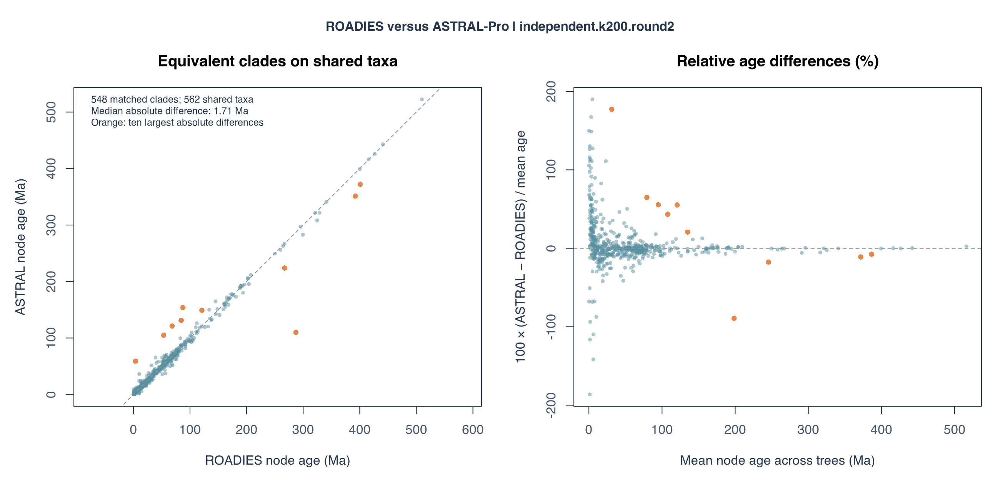

# MD-CAT dating

The updated `k200.round2` [MD-CAT](https://github.com/smirarab/MD-Cat) trees use independent calibration sampling for the main results and all checkpoint comparisons. Bottom-up trees and full-tree plots are retained as alternatives in each analysis folder. Node ages are means across 100 fitted runs, with 95% pooled-percentile intervals from 10,000 CI replicates. Ages and branch lengths are in Ma.

## Analyses

| Analysis | Tips | Independent tree | Node ages | Full-tree figure |
| --- | ---: | --- | --- | --- |
| [ROADIES v0.0.0](roadies_v1.1.16b/README.md) | 581 | [NEXUS](roadies_v1.1.16b/roadies_v1.1.16b.independent.k200.round2.tre) | [TSV](roadies_v1.1.16b/roadies_v1.1.16b.independent.k200.round2.tre.tsv) | [PDF](roadies_v1.1.16b/roadies_v1.1.16b.independent.k200.round2.pdf) |
| [ASTRAL v0.1.1](astralpro.l6p1/README.md) | 565 | [NEXUS](astralpro.l6p1/astralpro.l6p1.independent.k200.round2.tre) | [TSV](astralpro.l6p1/astralpro.l6p1.independent.k200.round2.tre.tsv) | [PDF](astralpro.l6p1/astralpro.l6p1.independent.k200.round2.pdf) |

## Figures and tables

The [plotting script](plot_mdcat.R) updates the independent overview, full-tree PDF, and node-age table for either topology:

```sh
Rscript dating/mdcat/plot_mdcat.R roadies_v1.1.16b
Rscript dating/mdcat/plot_mdcat.R astralpro.l6p1
```

Add `--strategy bottom-up` to produce the alternative full-tree PDF. Overview dots mark the current calibration nodes (105 ROADIES, 100 ASTRAL), and hairlines show the embedded 95% age intervals. Full-tree PDFs label the species and internal nodes, with calibration bounds and age summaries.

Node-age tables contain one row per tip or internal node, using APE node numbers. Columns give the mean age (`age`), 95% bounds (`t_lower`, `t_upper`), numbers of fitted runs and CI replicates, and descendant accessions (`descendant_tips`).

## Node-age comparison

```sh
Rscript dating/mdcat/plot_mdcat.R comparison
```

The comparison matches 548 clades among the 562 taxa shared by ROADIES and ASTRAL. The left panel compares their mean node ages against a line of equality. The right panel shows `100 × (ASTRAL − ROADIES) / mean age`; positive values indicate older ASTRAL estimates. Orange points mark the ten largest absolute differences.



The [comparison table](node_age_comparison.tsv) lists the paired nodes, ages, differences, and representative tips.
