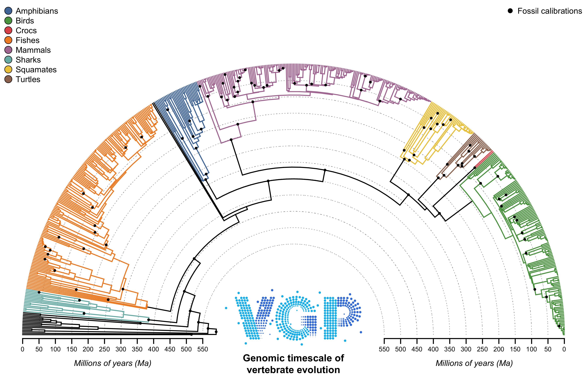

# Exploratory treePL analyses

[treePL](https://github.com/blackrim/treePL) provides exploratory dates using [fossil constraints](../../calibrations/README.md). Released dated trees are documented under [MD-CAT](../mdcat/README.md).

## Results

| Analysis | Calibrations | Smoothing | Config | Dated tree | Calibrated ages | Figures |
| --- | ---: | ---: | --- | --- | --- | --- |
| ROADIES | 105 | 1 | [Config](roadies_v1.1.16b/roadies_v1.1.16b.config) | [Accessions](roadies_v1.1.16b/generated/roadies_v1.1.16b.treePL.tre), [names](roadies_v1.1.16b/generated/roadies_v1.1.16b.scientific.treePL.tre) | [TSV](roadies_v1.1.16b/generated/roadies_v1.1.16b.calibrated_node_ages.tsv) | [Tree](roadies_v1.1.16b/generated/roadies_v1.1.16b.dated.pdf), [optimization](roadies_v1.1.16b/generated/optimization.png) |
| ASTRAL | 100 | 0.01 | [Config](astralpro.l6p1/astralpro.l6p1.config) | [Accessions](astralpro.l6p1/generated/astralpro.l6p1.treePL.tre), [names](astralpro.l6p1/generated/astralpro.l6p1.scientific.treePL.tre) | [TSV](astralpro.l6p1/generated/astralpro.l6p1.calibrated_node_ages.tsv) | [Tree](astralpro.l6p1/generated/astralpro.l6p1.dated.pdf), [optimization](astralpro.l6p1/generated/optimization.png) |

CV scores: [ROADIES](roadies_v1.1.16b/generated/optimization.tsv), [ASTRAL](astralpro.l6p1/generated/optimization.tsv). Ages and branch lengths are in Ma. Calibration bounds are hard limits in treePL.

The configs and benchmark use a patched version of treePL. The [patch](treepl.patch) fixes cross-validation sampling, optimizer selection, and numerical issues in treePL. It also allows the benchmark to carry useful fits between smoothing values. [Build instructions](#build-treepl) are below.



## Run the optimizer

The workflow requires Python 3.9+, R with `ape`, `ggplot2`, `jsonlite`,
`phytools`, `plotrix`, and `png`, and [patched treePL](#build-treepl).

The launcher first updates both configs from the master calibration list and checks the mappings. It then runs both trees and updates their configs, dated trees, and figures:

```sh
python3 dating/treePL/run_all.py --treepl /path/to/patched/treePL
```

The benchmark tests optimizer settings and uses cross-validation to compare
11 smoothing values from `1e4` to `1e-6`, using 15 CV replicates per value in
batches of up to five. Failed attempts are retried without reducing the replicate
count. It then improves the final fit at the
best smoothing value. The CV figure updates as results become available.

Tree paths in the config are relative to the config file. Use `--workers` to
set the worker limit; by default, the script uses all available logical
CPUs except one, with at most five CV fits at a time. Use `--replicates` when
calling the benchmark directly to change the number of CV replicates.
The benchmark writes its results to the output folder without
changing the input config.

## Build treePL

Download the specified treePL version and apply the [patch](treepl.patch). This builds a separate executable and does not change an existing treePL installation:

```sh
curl -L https://github.com/blackrim/treePL/archive/551cbde1a530adad7986c530ca1f254e3ffd42c7.tar.gz -o treePL.tar.gz
tar -xzf treePL.tar.gz
cd treePL-551cbde1a530adad7986c530ca1f254e3ffd42c7
patch -p1 < /absolute/path/to/vgp-dating/dating/treePL/treepl.patch
cd src
```

Tested macOS/Homebrew build, using the treePL, NLopt, and OpenMP dependencies (adjust paths and compiler flags for other systems; see the [upstream build instructions](https://github.com/blackrim/treePL)):

```sh
TREEPL_CPPFLAGS='-I/opt/homebrew/opt/treepl/libexec/include -I/opt/homebrew/opt/nlopt/include -I/opt/homebrew/opt/libomp/include'
TREEPL_LDFLAGS='-L/opt/homebrew/opt/nlopt/lib -L/opt/homebrew/opt/treepl/libexec/lib -L/opt/homebrew/opt/libomp/lib'
./configure CC=/usr/bin/clang CXX=/usr/bin/clang++ CPPFLAGS="$TREEPL_CPPFLAGS" LDFLAGS="$TREEPL_LDFLAGS"
make all -j2 CPPFLAGS="$TREEPL_CPPFLAGS" CFLAGS="$TREEPL_CPPFLAGS" LDFLAGS="$TREEPL_LDFLAGS" OPENMP='-Xpreprocessor -fopenmp -lomp'
./treePL --version
```

The version must include `vgp-optimizer-fixes-8`. Use this executable with `--treepl`; no installation step is needed. Rebuild from clean objects after changing the patch.

## Figures and checks

The [plotting script](plot_treepl.R) produces the overview, scientific-name
tree, calibration-age table, and full-tree PDF. It requires `ape`, `phytools`,
`plotrix`, and `png`. The launcher runs it for both trees. To regenerate one
set of plots manually:

```sh
Rscript dating/treePL/plot_treepl.R roadies_v1.1.16b  # ROADIES
Rscript dating/treePL/plot_treepl.R astralpro.l6p1    # ASTRAL
```

From the repository root, `Rscript dating/treePL/calibration_config.R --update` updates both configs from the master list and checks the mappings. Omit `--update` to check without changing files.
