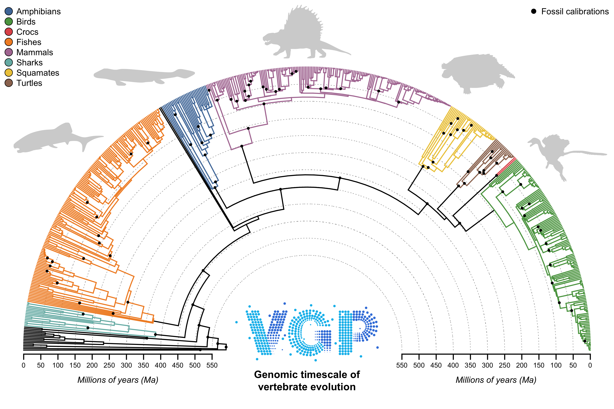

# treePL testing ground

This folder is just for running tests using [treePL](https://github.com/blackrim/treePL) to see how the tree responds to different constraints. Here is an example with the current [constraints](/calibrations/calibrations.md):

---

The shared [treePL benchmarking script](treepl_benchmark.py) checks the input configuration against the [master calibration list](/calibrations/master_calibrations.csv), then selects smoothing using replicated random cross-validation, with a short optimizer screen at each smoothing value. By default, it collects 64 accepted CV scores per value, rejects extreme numerical outliers, and selects the lowest median score (favoring higher smoothing only for exact ties). At the selected smoothing, it compares 144 optimizer configurations across three shared seeds, then runs longer searches with 50 additional seeds for each of up to two selected configurations. It retains the best valid fit across these stages, repeats its settings for confirmation, updates the final configuration, and produces dated trees and summary plots. Smoothing values and search budgets are adjustable; evaluation records are retained in compressed form.
